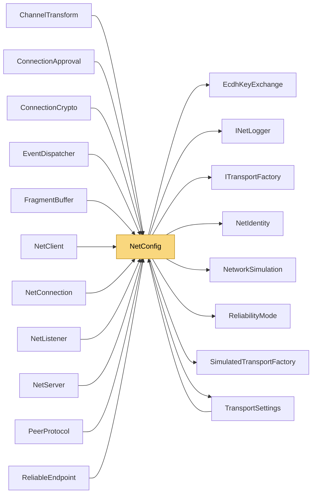

# NetConfig

> [!info] Generated by `tools/generate-vault.py` from the source — do not edit by hand; rerun the script after code changes.

Shared configuration for `NetClient` and `NetServer`. Client and server must agree on the channel table (same ids, same transports). When `Channels` is left empty, two defaults are used: channel 0 = TCP, channel 1 = UDP.

**Namespace** `NetSync` · **Folder** [[Module map root|(root)]] · **Layer** API

**Source** `src/NetSync/NetConfig.cs`

## Types

| Type | Kind | Summary |
|---|---|---|
| `TransportType` | public enum | A transport slot. The name says what runs there by default; the contract is what matters when you plug in your own implementation via `TransportFactories`. |
| `EventDelivery` | public enum |  |
| `KeyExchangeMode` | public enum |  |
| `ReconnectPolicy` | public sealed class | Exponential backoff with jitter for `Reconnect`. |
| `EncryptionConfig` | public sealed class | How per-connection encryption keys are established. |
| `ChannelConfig` | public sealed class | A logical channel: which transport carries it and with what guarantees. |
| `NetConfig` | public sealed class | Shared configuration for `NetClient` and `NetServer`. Client and server must agree on the channel table (same ids, same transports). When `Channels` is left empty, two defaults are used: channel 0 = TCP, channel 1 = UDP. |

## Members

**ReconnectPolicy**

- `public int MaxAttempts`
- `public int InitialDelayMs`
- `public int MaxDelayMs`

**EncryptionConfig**

- `public KeyExchangeMode Mode`
- `public byte[]? PresharedKey`
- `public NetIdentity? ServerIdentity`
- `public List<byte[]> TrustedServerKeys`

**ChannelConfig**

- `public TransportType Transport`
- `public ReliabilityMode Reliability`
- `public bool Compression`
- `public bool Encryption`
- `public ChannelPriority Priority`
- `internal bool NeedsTransform`
- `public ChannelConfig()`
- `public ChannelConfig(TransportType transport, ReliabilityMode reliability = ReliabilityMode.Unreliable,`

**NetConfig**

- `public Dictionary<byte, ChannelConfig> Channels`
- `public EventDelivery EventDelivery`
- `public int PingIntervalMs`
- `public int PingTimeoutMs`
- `public int ConnectTimeoutMs`
- `public const int DefaultMaxMessageSize = 16 * 1024 * 1024`
- `public int MaxMessageSize`
- `public int WriteTimeoutMs`
- `public int MaxPendingEvents`
- `public int MaxConnections`
- `public EncryptionConfig Encryption`
- `public Dictionary<TransportType, Transports.ITransportFactory> TransportFactories`
- `public bool RequireAllTransports`
- `public int TransportFallbackTimeoutMs`
- `public bool MtuDiscovery`
- `public ReconnectPolicy? Reconnect`
- `public Transports.Simulation.NetworkSimulation? Simulation`
- `public INetLogger Logger`
- `internal Dictionary<byte, ChannelConfig> BuildChannelTable()`
- `internal int WireMessageLimit`
- `internal Transports.ITransportFactory GetTransportFactory(TransportType slot)`
- `internal Transports.TransportSettings BuildTransportSettings()`
- `internal uint ComputeConfigHash(Dictionary<byte, ChannelConfig> channelTable)`
- `internal void ValidateLimits()`
- `internal void ValidateSecurity(Dictionary<byte, ChannelConfig> channelTable)`
- `internal static bool HasReliableUdpChannels(Dictionary<byte, ChannelConfig> channelTable)`
- `internal ChannelConfig ResolveOutgoing(Dictionary<byte, ChannelConfig> channelTable, byte channel, int length)`
- `internal List<TransportType> BuildTransportList(Dictionary<byte, ChannelConfig> channelTable)`

## Depends on (8)

- **Pipeline/Reliability**: [[ReliabilityMode]] (`ChannelPriority`, `ReliabilityMode`)
- **Pipeline/Security**: [[EcdhKeyExchange]], [[NetIdentity]]
- **Transports**: [[ITransportFactory]] (`ITransportFactory`, `TcpTransportFactory`, `UdpTransportFactory`), [[TransportSettings]]
- **Transports/Simulation**: [[NetworkSimulation]], [[SimulatedTransportFactory]]
- **Diagnostics**: [[INetLogger]] (`INetLogger`, `NullNetLogger`)

## Used by (12)

- **Peers**: [[ChannelTransform]] (`ChannelConfig`), [[ConnectionApproval]] (`TransportType`), [[EventDispatcher]] (`EventDelivery`), [[NetClient]] (`ChannelConfig`, `EventDelivery`, `KeyExchangeMode`, `NetConfig`, `ReconnectPolicy`, `TransportType`), [[NetConnection]] (`TransportType`), [[NetListener]] (`TransportType`), [[NetServer]] (`ChannelConfig`, `EventDelivery`, `KeyExchangeMode`, `NetConfig`, `TransportType`), [[PeerProtocol]] (`KeyExchangeMode`)
- **Pipeline/Reliability**: [[ReliableEndpoint]] (`ChannelConfig`, `NetConfig`, `TransportType`)
- **Pipeline/Security**: [[ConnectionCrypto]] (`TransportType`)
- **Transports**: [[TransportSettings]]
- **Pipeline/Fragmentation**: [[FragmentBuffer]]

## Neighbourhood

