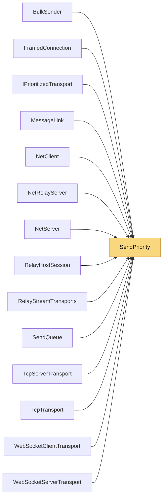

# SendPriority

> [!NOTE]
> Generated by `tools/generate-vault.py` from the source — do not edit by hand; rerun the script after code changes.

**Namespace** `NetSync.Sending` · **Folder** [Sending](../../4%20Diagrams/Modules/Module%20map%20Sending.md) · **Layer** Infrastructure

**Source** `src/NetSync/Sending/SendPriority.cs`

## Types

| Type | Kind | Summary |
|---|---|---|
| `SendPriority` | public enum |  |

## Depends on (0)

—

## Used by (14)

- **Peers**: [NetClient](../Peers/NetClient.md), [NetServer](../Peers/NetServer.md)
- **Transports**: [BulkSender](../Transports/BulkSender.md), [IPrioritizedTransport](../Transports/IPrioritizedTransport.md), [MessageLink](../Transports/MessageLink.md)
- **Transports/Tcp**: [TcpServerTransport](../Transports/Tcp/TcpServerTransport.md), [TcpTransport](../Transports/Tcp/TcpTransport.md)
- **Transports/WebSockets**: [WebSocketClientTransport](../Transports/WebSockets/WebSocketClientTransport.md), [WebSocketServerTransport](../Transports/WebSockets/WebSocketServerTransport.md)
- **Relay**: [FramedConnection](../Relay/FramedConnection.md), [NetRelayServer](../Relay/NetRelayServer.md), [RelayHostSession](../Relay/RelayHostSession.md), [RelayStreamTransports](../Relay/RelayStreamTransports.md)
- **Sending**: [SendQueue](SendQueue.md)

## Neighbourhood

