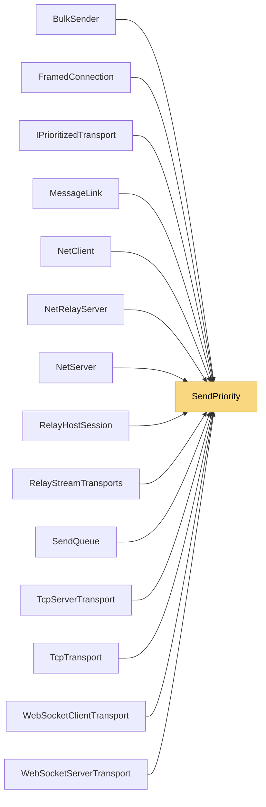

# SendPriority

> [!info] Generated by `tools/generate-vault.py` from the source — do not edit by hand; rerun the script after code changes.

**Namespace** `NetSync.Sending` · **Folder** [[Module map Sending|Sending]] · **Layer** Infrastructure

**Source** `src/NetSync/Sending/SendPriority.cs`

## Types

| Type | Kind | Summary |
|---|---|---|
| `SendPriority` | public enum |  |

## Depends on (0)

—

## Used by (14)

- **Peers**: [[NetClient]], [[NetServer]]
- **Transports**: [[BulkSender]], [[IPrioritizedTransport]], [[MessageLink]]
- **Transports/Tcp**: [[TcpServerTransport]], [[TcpTransport]]
- **Transports/WebSockets**: [[WebSocketClientTransport]], [[WebSocketServerTransport]]
- **Relay**: [[FramedConnection]], [[NetRelayServer]], [[RelayHostSession]], [[RelayStreamTransports]]
- **Sending**: [[SendQueue]]

## Neighbourhood

