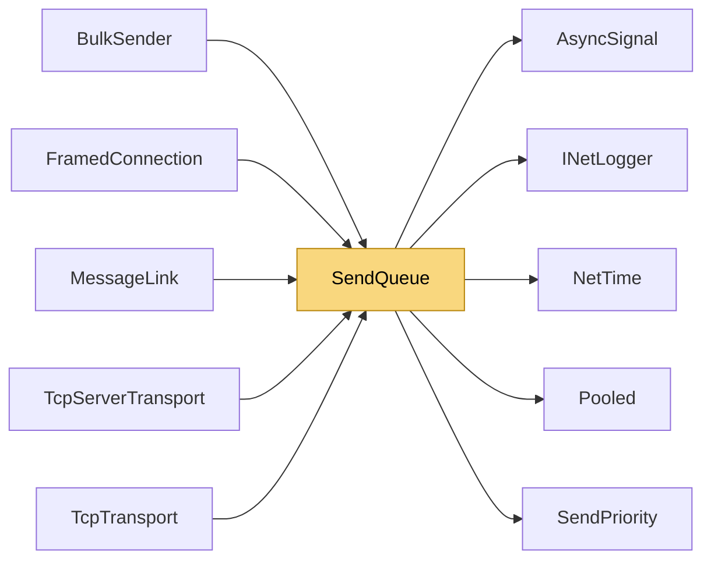

# SendQueue

> [!info] Generated by `tools/generate-vault.py` from the source — do not edit by hand; rerun the script after code changes.

Priority send queue with a dedicated drain loop. - Wakes exactly when work arrives, without allocating (`AsyncSignal`). After an idle period the first write happens on the enqueuing thread itself. - Optional coalescing: consecutive small frames are copied into one pooled batch and written with a single socket call — far fewer syscalls under load, while a lone message still goes out immediately (no Nagle-style delay). - Bounded: `TryEnqueue` fails fast when full (real-time traffic), `EnqueueAsync` waits for space (bulk transfers — backpressure instead of failing halfway through a file). Bulk is additionally capped in bytes, so streaming a huge file holds only a few MB in the queue. - Pooled buffers are returned after the write, or when the queue shuts down. - `WriteStartedAtMs` lets the owner detect a write that never completes (remote stopped reading) on every runtime, including ones where socket writes ignore cancellation.

**Namespace** `NetSync.Sending` · **Folder** [[Module map Sending|Sending]] · **Layer** Infrastructure

**Source** `src/NetSync/Sending/SendQueue.cs`

## Types

| Type | Kind | Summary |
|---|---|---|
| `SendQueue` | internal sealed class | Priority send queue with a dedicated drain loop. - Wakes exactly when work arrives, without allocating (`AsyncSignal`). After an idle period the first write happens on the enqueuing thread itself. - Optional… |
| ↳ `Job` | private struct |  |

## Extends / implements

- `SendQueue` → `IDisposable`

## Members

**SendQueue**

- `public int Count`
- `public long WriteStartedAtMs`
- `public long QueuedBytes`
- `public SendQueue(Func<byte[], int, CancellationToken, Task> sendFunc, INetLogger logger, int maxQueueSize = 10_000,`
- `public SendQueue(Func<byte[], int, CancellationToken, ValueTask> write, int coalesceBytes, INetLogger logger,`
- `public void Start()`
- `public bool TryEnqueue(byte[] buffer, int length, bool pooled, SendPriority priority)`
- `public async ValueTask EnqueueAsync(byte[] buffer, int length, bool pooled, SendPriority priority, CancellationToken ct)`
- `public void Dispose()`

## Depends on (5)

- **Sending**: [[SendPriority]]
- **Diagnostics**: [[INetLogger]]
- **Internal**: [[AsyncSignal]], [[NetTime]], [[Pooled]]

## Used by (5)

- **Transports**: [[BulkSender]], [[MessageLink]]
- **Transports/Tcp**: [[TcpServerTransport]], [[TcpTransport]]
- **Relay**: [[FramedConnection]]

## Neighbourhood

