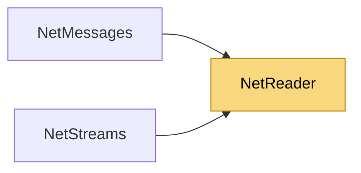

# NetReader

> [!info] Generated by `tools/generate-vault.py` from the source — do not edit by hand; rerun the script after code changes.

Counterpart of `NetWriter`: reads primitives from a received payload. Throws `EndOfStreamException` on malformed/truncated input — always wrap parsing of untrusted data in a try/catch.

**Namespace** `NetSync.Serialization` · **Folder** [[Module map Serialization|Serialization]] · **Layer** Foundation

**Source** `src/NetSync/Serialization/NetReader.cs`

## Types

| Type | Kind | Summary |
|---|---|---|
| `NetReader` | public sealed class | Counterpart of `NetWriter`: reads primitives from a received payload. Throws `EndOfStreamException` on malformed/truncated input — always wrap parsing of untrusted data in a try/catch. |

## Members

**NetReader**

- `public int Position`
- `public int Remaining`
- `public NetReader(ReadOnlyMemory<byte> data)`
- `public NetReader(byte[] data) : this(new ReadOnlyMemory<byte>(data))`
- `internal void Reset(ReadOnlyMemory<byte> data)`
- `public byte ReadByte()`
- `public bool ReadBool()`
- `public short ReadInt16()`
- `public ushort ReadUInt16()`
- `public int ReadInt32()`
- `public uint ReadUInt32()`
- `public long ReadInt64()`
- `public ulong ReadUInt64()`
- `public float ReadSingle()`
- `public double ReadDouble()`
- `public uint ReadVarUInt()`
- `public int ReadVarInt()`
- `public string ReadString()`
- `public byte[] ReadBytes()`
- `public ReadOnlyMemory<byte> ReadBytesMemory()`
- `public byte[] ReadRaw(int count)`
- `public Guid ReadGuid()`

## Depends on (0)

—

## Used by (2)

- **Messaging**: [[NetMessages]]
- **Streams**: [[NetStreams]]

## Neighbourhood

