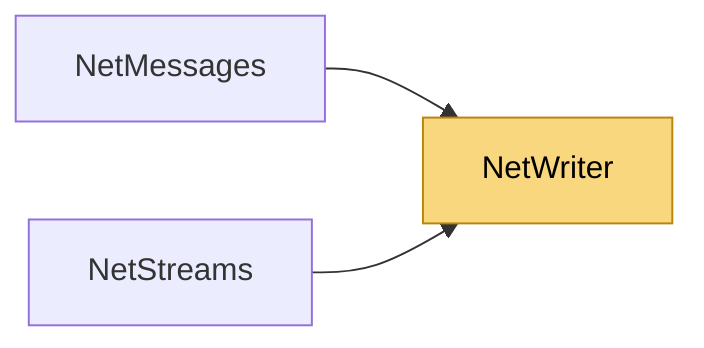

# NetWriter

> [!info] Generated by `tools/generate-vault.py` from the source — do not edit by hand; rerun the script after code changes.

Compact binary writer for building message payloads — the replacement for the 1.x string-based JsonMessage. Little-endian fixed-width primitives, LEB128 var-ints, length-prefixed UTF-8 strings. Reusable: call `Reset` and write the next message into the same buffer.

**Namespace** `NetSync.Serialization` · **Folder** [[Module map Serialization|Serialization]] · **Layer** Foundation

**Source** `src/NetSync/Serialization/NetWriter.cs`

## Types

| Type | Kind | Summary |
|---|---|---|
| `NetWriter` | public sealed class | Compact binary writer for building message payloads — the replacement for the 1.x string-based JsonMessage. Little-endian fixed-width primitives, LEB128 var-ints, length-prefixed UTF-8 strings. Reusable: call `Reset`… |

## Members

**NetWriter**

- `public int Length`
- `public ReadOnlyMemory<byte> WrittenMemory`
- `public NetWriter(int initialCapacity = 256)`
- `public void Reset()`
- `public byte[] ToArray()`
- `public NetWriter WriteByte(byte value)`
- `public NetWriter WriteBool(bool value)`
- `public NetWriter WriteInt16(short value)`
- `public NetWriter WriteUInt16(ushort value)`
- `public NetWriter WriteInt32(int value)`
- `public NetWriter WriteUInt32(uint value)`
- `public NetWriter WriteInt64(long value)`
- `public NetWriter WriteUInt64(ulong value)`
- `public NetWriter WriteSingle(float value)`
- `public NetWriter WriteDouble(double value)`
- `public NetWriter WriteVarUInt(uint value)`
- `public NetWriter WriteVarInt(int value)`
- `public NetWriter WriteString(string? value)`
- `public NetWriter WriteBytes(ReadOnlySpan<byte> value)`
- `public NetWriter WriteRaw(ReadOnlySpan<byte> value)`
- `public NetWriter WriteGuid(Guid value)`

## Depends on (0)

—

## Used by (2)

- **Messaging**: [[NetMessages]]
- **Streams**: [[NetStreams]]

## Neighbourhood

