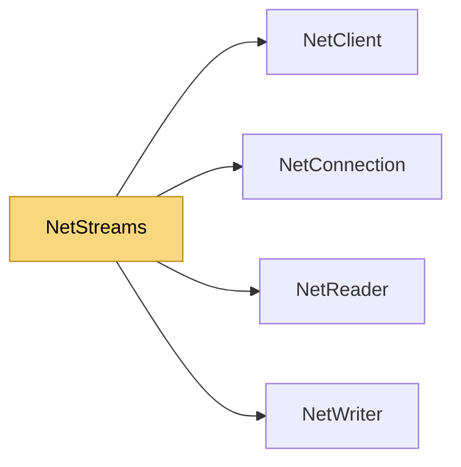

# NetStreams

> [!info] Generated by `tools/generate-vault.py` from the source — do not edit by hand; rerun the script after code changes.

Sends arbitrarily large data (files, recordings) as a sequence of chunk messages, with memory bounded by the transport's backpressure — never the whole payload. Use a dedicated channel that is ordered and reliable (TCP, or UDP with `ReliableOrdered`); consider `Low` so transfers yield to real-time traffic. On the receiving side feed every message of that channel to a `NetStreamReceiver` (one per sender).

**Namespace** `NetSync.Streams` · **Folder** [[Module map Streams|Streams]] · **Layer** API

**Source** `src/NetSync/Streams/NetStreams.cs`

## Types

| Type | Kind | Summary |
|---|---|---|
| `NetStreamInfo` | public sealed class | Metadata of a stream being received. |
| `NetStreams` | public static class | Sends arbitrarily large data (files, recordings) as a sequence of chunk messages, with memory bounded by the transport's backpressure — never the whole payload. Use a dedicated channel that is ordered and reliable… |
| `NetStreamReceiver` | public sealed class | Reassembles streams sent with `NetStreams`: writes each chunk to a destination stream as it arrives. Create one per sender (per connection on a server) and call `HandleMessage` for every message of the stream… |

## Extends / implements

- `NetStreamReceiver` → `IDisposable`

## Members

**NetStreamInfo**

- `public uint StreamId`
- `public string Name`
- `public long Length`
- `public long BytesReceived`
- `internal NetStreamInfo(uint streamId, string name, long length)`
- `public override string ToString()`

**NetStreams**

- `public const int DefaultChunkSize = 256 * 1024`
- `internal const byte KindBegin = 1`
- `internal const byte KindChunk = 2`
- `internal const byte KindEnd = 3`
- `internal const byte KindAbort = 4`
- `internal const int ChunkHeaderSize = 5`
- `public static Task SendStreamAsync(this NetClient client, byte channel, Stream source, string name = "",`
- `public static Task SendStreamAsync(this NetConnection connection, byte channel, Stream source, string name = "",`
- `public static async Task SendAsync(Func<ReadOnlyMemory<byte>, CancellationToken, ValueTask> send, Stream source,`

**NetStreamReceiver**

- `public bool DisposeDestinations`
- `public int MaxActiveStreams`
- `public event Action<NetStreamInfo>? StreamStarted`
- `public event Action<NetStreamInfo>? StreamCompleted`
- `public event Action<NetStreamInfo, string>? StreamFailed`
- `public event Action<NetStreamInfo>? StreamRefused`
- `public NetStreamReceiver(Func<NetStreamInfo, Stream> openDestination)`
- `public int ActiveStreams`
- `public void HandleMessage(byte[] message)`
- `public void HandleMessage(ReadOnlyMemory<byte> message)`
- `public void Dispose()`

## Depends on (4)

- **Peers**: [[NetClient]], [[NetConnection]]
- **Serialization**: [[NetReader]], [[NetWriter]]

## Used by (0)

—

## Neighbourhood

