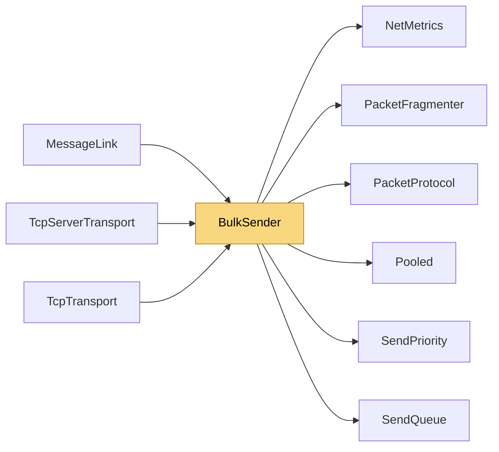

# BulkSender

> [!info] Generated by `tools/generate-vault.py` from the source — do not edit by hand; rerun the script after code changes.

Sends a large message as fragment frames through a send queue, with backpressure — for stream links (TCP frames: [type][length][body]) and message links (WebSocket messages: [type][body]) alike. Contract kept for callers: the message memory is only read before SendAsync returns. Fragments are cut straight from prefix‖payload while the queue has room; the moment the queue makes us wait, the rest of the message is copied into one pooled buffer and the transfer continues from there. The common case copies nothing extra, and a caller can always reuse (or pool-return) its buffer at once.

**Namespace** `NetSync.Transports` · **Folder** [[Module map Transports|Transports]] · **Layer** Transports

**Source** `src/NetSync/Transports/BulkSender.cs`

## Types

| Type | Kind | Summary |
|---|---|---|
| `BulkSender` | internal static class | Sends a large message as fragment frames through a send queue, with backpressure — for stream links (TCP frames: [type][length][body]) and message links (WebSocket messages: [type][body]) alike. Contract kept for… |

## Members

**BulkSender**

- `public static ValueTask SendAsync(SendQueue queue, ReadOnlyMemory<byte> prefix, ReadOnlyMemory<byte> payload,`

## Depends on (6)

- **Transports**: [[PacketProtocol]]
- **Sending**: [[SendPriority]], [[SendQueue]]
- **Pipeline/Fragmentation**: [[PacketFragmenter]]
- **Diagnostics**: [[NetMetrics]]
- **Internal**: [[Pooled]]

## Used by (3)

- **Transports**: [[MessageLink]]
- **Transports/Tcp**: [[TcpServerTransport]], [[TcpTransport]]

## Neighbourhood

