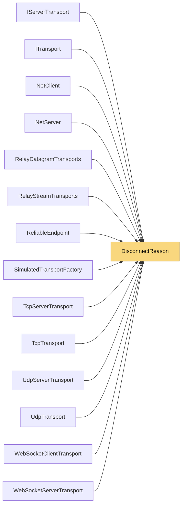

# DisconnectReason

> [!NOTE]
> Generated by `tools/generate-vault.py` from the source — do not edit by hand; rerun the script after code changes.

Why a connection ended. Replaces the old OnDisconnected/OnServerDisconnected event pair: subscribers get a single event with an explicit reason.

**Namespace** `NetSync.Transports` · **Folder** [Transports](../../4%20Diagrams/Modules/Module%20map%20Transports.md) · **Layer** Transports

**Source** `src/NetSync/Transports/DisconnectReason.cs`

## Types

| Type | Kind | Summary |
|---|---|---|
| `DisconnectReason` | public enum | Why a connection ended. Replaces the old OnDisconnected/OnServerDisconnected event pair: subscribers get a single event with an explicit reason. |

## Depends on (0)

—

## Used by (14)

- **Peers**: [NetClient](../Peers/NetClient.md), [NetServer](../Peers/NetServer.md)
- **Pipeline/Reliability**: [ReliableEndpoint](../Pipeline/Reliability/ReliableEndpoint.md)
- **Transports**: [IServerTransport](IServerTransport.md), [ITransport](ITransport.md)
- **Transports/Tcp**: [TcpServerTransport](Tcp/TcpServerTransport.md), [TcpTransport](Tcp/TcpTransport.md)
- **Transports/Udp**: [UdpServerTransport](Udp/UdpServerTransport.md), [UdpTransport](Udp/UdpTransport.md)
- **Transports/WebSockets**: [WebSocketClientTransport](WebSockets/WebSocketClientTransport.md), [WebSocketServerTransport](WebSockets/WebSocketServerTransport.md)
- **Transports/Simulation**: [SimulatedTransportFactory](Simulation/SimulatedTransportFactory.md)
- **Relay**: [RelayDatagramTransports](../Relay/RelayDatagramTransports.md), [RelayStreamTransports](../Relay/RelayStreamTransports.md)

## Neighbourhood

