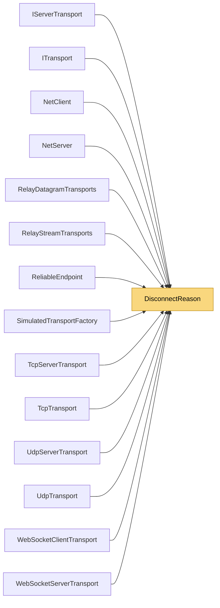

# DisconnectReason

> [!info] Generated by `tools/generate-vault.py` from the source — do not edit by hand; rerun the script after code changes.

Why a connection ended. Replaces the old OnDisconnected/OnServerDisconnected event pair: subscribers get a single event with an explicit reason.

**Namespace** `NetSync.Transports` · **Folder** [[Module map Transports|Transports]] · **Layer** Transports

**Source** `src/NetSync/Transports/DisconnectReason.cs`

## Types

| Type | Kind | Summary |
|---|---|---|
| `DisconnectReason` | public enum | Why a connection ended. Replaces the old OnDisconnected/OnServerDisconnected event pair: subscribers get a single event with an explicit reason. |

## Depends on (0)

—

## Used by (14)

- **Peers**: [[NetClient]], [[NetServer]]
- **Pipeline/Reliability**: [[ReliableEndpoint]]
- **Transports**: [[IServerTransport]], [[ITransport]]
- **Transports/Tcp**: [[TcpServerTransport]], [[TcpTransport]]
- **Transports/Udp**: [[UdpServerTransport]], [[UdpTransport]]
- **Transports/WebSockets**: [[WebSocketClientTransport]], [[WebSocketServerTransport]]
- **Transports/Simulation**: [[SimulatedTransportFactory]]
- **Relay**: [[RelayDatagramTransports]], [[RelayStreamTransports]]

## Neighbourhood

