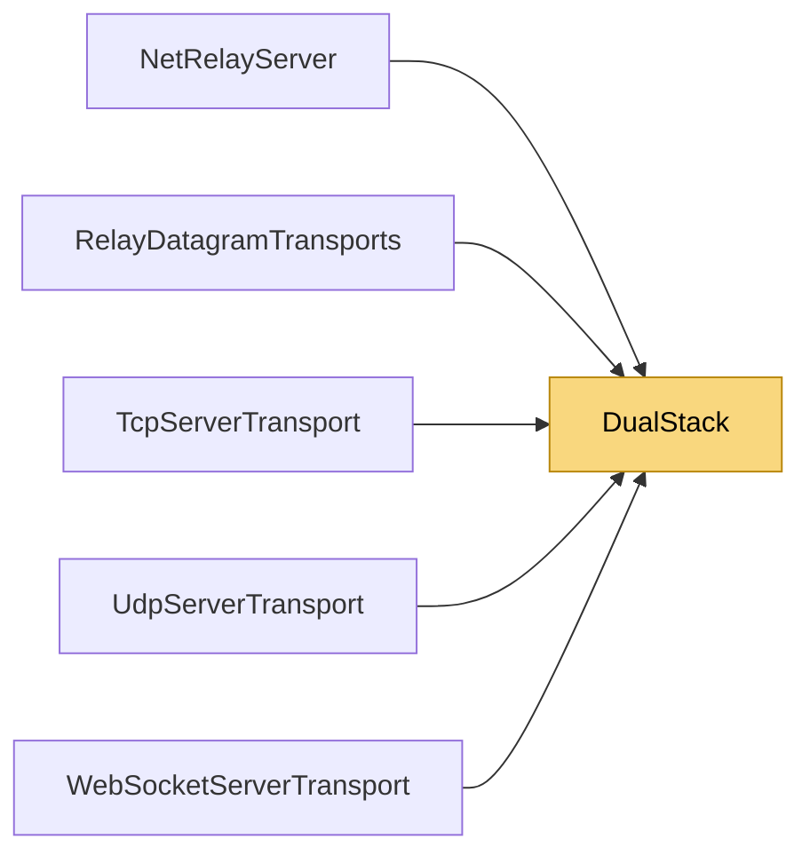

# DualStack

> [!info] Generated by `tools/generate-vault.py` from the source — do not edit by hand; rerun the script after code changes.

Server sockets that accept IPv4 and IPv6 clients on one port (dual-stack), with an automatic IPv4-only fallback where the OS or runtime lacks IPv6. Apple's App Store review runs apps on IPv6-only (NAT64) networks, so servers reachable over IPv6 matter for mobile games.

**Namespace** `NetSync.Transports` · **Folder** [[Module map Transports|Transports]] · **Layer** Transports

**Source** `src/NetSync/Transports/DualStack.cs`

## Types

| Type | Kind | Summary |
|---|---|---|
| `DualStack` | internal static class | Server sockets that accept IPv4 and IPv6 clients on one port (dual-stack), with an automatic IPv4-only fallback where the OS or runtime lacks IPv6. Apple's App Store review runs apps on IPv6-only (NAT64) networks, so… |

## Members

**DualStack**

- `public static TcpListener StartTcpListener(int port)`
- `public static IPEndPoint Normalize(IPEndPoint endPoint)`

## Depends on (0)

—

## Used by (5)

- **Transports/Tcp**: [[TcpServerTransport]]
- **Transports/Udp**: [[UdpServerTransport]]
- **Transports/WebSockets**: [[WebSocketServerTransport]]
- **Relay**: [[NetRelayServer]], [[RelayDatagramTransports]]

## Neighbourhood

