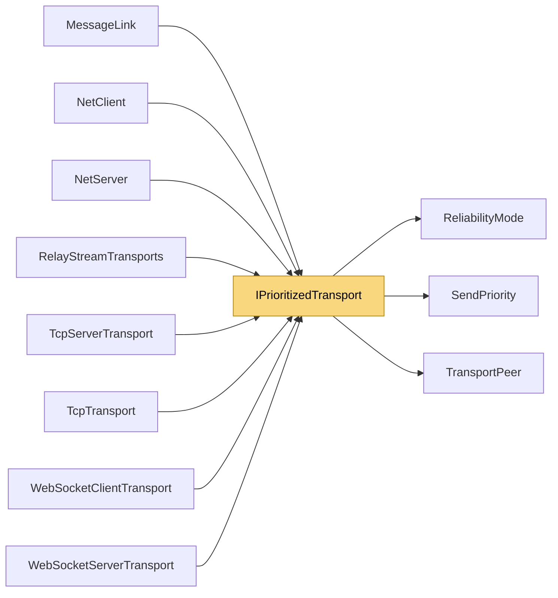

# IPrioritizedTransport

> [!NOTE]
> Generated by `tools/generate-vault.py` from the source — do not edit by hand; rerun the script after code changes.

Optional capability: a client transport with an internal send queue can honor per-channel priority (`ChannelPriority`). The peer layer uses it when present and falls back to plain SendAsync otherwise.

**Namespace** `NetSync.Transports` · **Folder** [Transports](../../4%20Diagrams/Modules/Module%20map%20Transports.md) · **Layer** Transports

**Source** `src/NetSync/Transports/IPrioritizedTransport.cs`

## Types

| Type | Kind | Summary |
|---|---|---|
| `IPrioritizedTransport` | public interface | Optional capability: a client transport with an internal send queue can honor per-channel priority (`ChannelPriority`). The peer layer uses it when present and falls back to plain SendAsync otherwise. |
| `IPrioritizedServerTransport` | public interface | Server-side counterpart of `IPrioritizedTransport`. |
| `PriorityMapping` | internal static class |  |

## Members

**PriorityMapping**

- `public static SendPriority ToSendPriority(ChannelPriority priority)`
- `public static SendPriority ForFragments(SendPriority priority)`

## Depends on (3)

- **Pipeline/Reliability**: [ReliabilityMode](../Pipeline/Reliability/ReliabilityMode.md) (`ChannelPriority`)
- **Transports**: [TransportPeer](TransportPeer.md)
- **Sending**: [SendPriority](../Sending/SendPriority.md)

## Used by (8)

- **Peers**: [NetClient](../Peers/NetClient.md) (`IPrioritizedTransport`, `PriorityMapping`), [NetServer](../Peers/NetServer.md) (`IPrioritizedServerTransport`, `PriorityMapping`)
- **Transports**: [MessageLink](MessageLink.md) (`PriorityMapping`)
- **Transports/Tcp**: [TcpServerTransport](Tcp/TcpServerTransport.md) (`IPrioritizedServerTransport`, `PriorityMapping`), [TcpTransport](Tcp/TcpTransport.md) (`IPrioritizedTransport`, `PriorityMapping`)
- **Transports/WebSockets**: [WebSocketClientTransport](WebSockets/WebSocketClientTransport.md), [WebSocketServerTransport](WebSockets/WebSocketServerTransport.md) (`IPrioritizedServerTransport`)
- **Relay**: [RelayStreamTransports](../Relay/RelayStreamTransports.md) (`IPrioritizedServerTransport`, `IPrioritizedTransport`)

## Neighbourhood

