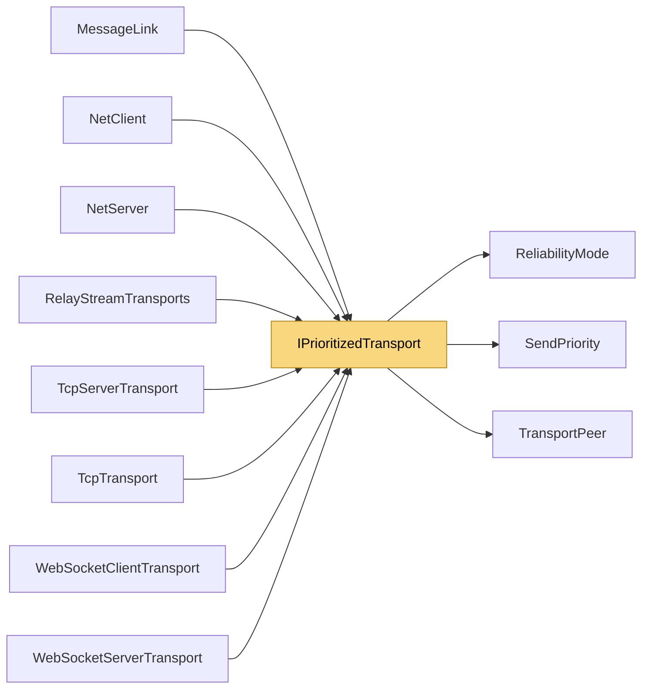

# IPrioritizedTransport

> [!info] Generated by `tools/generate-vault.py` from the source — do not edit by hand; rerun the script after code changes.

Optional capability: a client transport with an internal send queue can honor per-channel priority (`ChannelPriority`). The peer layer uses it when present and falls back to plain SendAsync otherwise.

**Namespace** `NetSync.Transports` · **Folder** [[Module map Transports|Transports]] · **Layer** Transports

**Source** `src/NetSync/Transports/IPrioritizedTransport.cs`

## Types

| Type | Kind | Summary |
|---|---|---|
| `IPrioritizedTransport` | public interface | Optional capability: a client transport with an internal send queue can honor per-channel priority (`ChannelPriority`). The peer layer uses it when present and falls back to plain SendAsync otherwise. |
| `IPrioritizedServerTransport` | public interface | Server-side counterpart of `IPrioritizedTransport`. |
| `PriorityMapping` | internal static class |  |

## Members

**PriorityMapping**

- `public static SendPriority ToSendPriority(ChannelPriority priority)`
- `public static SendPriority ForFragments(SendPriority priority)`

## Depends on (3)

- **Pipeline/Reliability**: [[ReliabilityMode]] (`ChannelPriority`)
- **Transports**: [[TransportPeer]]
- **Sending**: [[SendPriority]]

## Used by (8)

- **Peers**: [[NetClient]] (`IPrioritizedTransport`, `PriorityMapping`), [[NetServer]] (`IPrioritizedServerTransport`, `PriorityMapping`)
- **Transports**: [[MessageLink]] (`PriorityMapping`)
- **Transports/Tcp**: [[TcpServerTransport]] (`IPrioritizedServerTransport`, `PriorityMapping`), [[TcpTransport]] (`IPrioritizedTransport`, `PriorityMapping`)
- **Transports/WebSockets**: [[WebSocketClientTransport]], [[WebSocketServerTransport]] (`IPrioritizedServerTransport`)
- **Relay**: [[RelayStreamTransports]] (`IPrioritizedServerTransport`, `IPrioritizedTransport`)

## Neighbourhood

