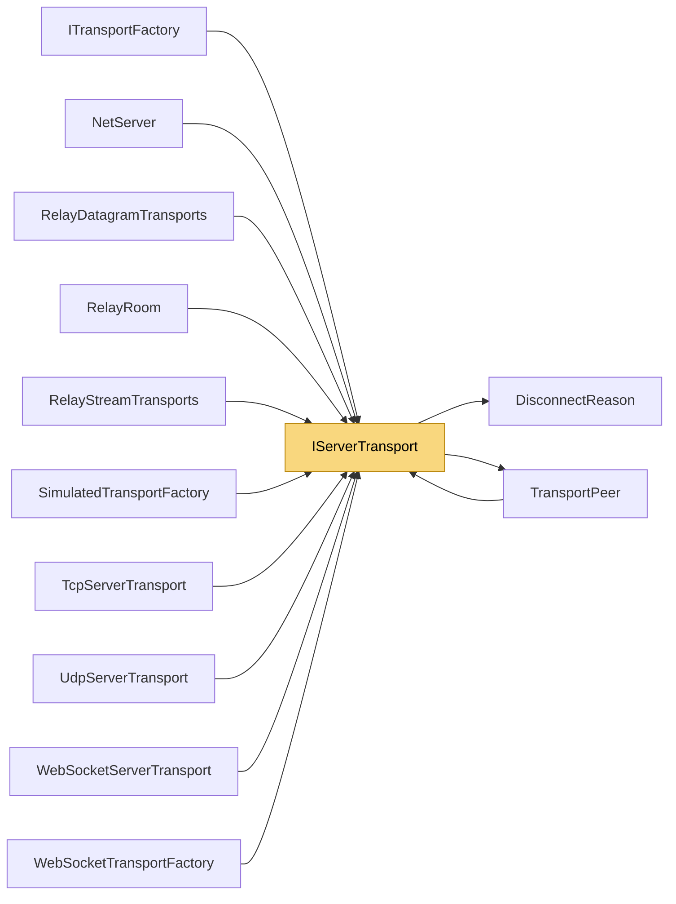

# IServerTransport

> [!info] Generated by `tools/generate-vault.py` from the source — do not edit by hand; rerun the script after code changes.

Server-side transport: listens on a port and manages many peers. Events are raised on background network threads (see `ITransport` notes).

**Namespace** `NetSync.Transports` · **Folder** [[Module map Transports|Transports]] · **Layer** Transports

**Source** `src/NetSync/Transports/IServerTransport.cs`

## Types

| Type | Kind | Summary |
|---|---|---|
| `IServerTransport` | public interface | Server-side transport: listens on a port and manages many peers. Events are raised on background network threads (see `ITransport` notes). |

## Extends / implements

- `IServerTransport` → `IDisposable`

## Depends on (2)

- **Transports**: [[DisconnectReason]], [[TransportPeer]]

## Used by (11)

- **Peers**: [[NetServer]]
- **Transports**: [[ITransportFactory]], [[TransportPeer]]
- **Transports/Tcp**: [[TcpServerTransport]]
- **Transports/Udp**: [[UdpServerTransport]]
- **Transports/WebSockets**: [[WebSocketServerTransport]], [[WebSocketTransportFactory]]
- **Transports/Simulation**: [[SimulatedTransportFactory]]
- **Relay**: [[RelayDatagramTransports]], [[RelayRoom]], [[RelayStreamTransports]]

## Neighbourhood

