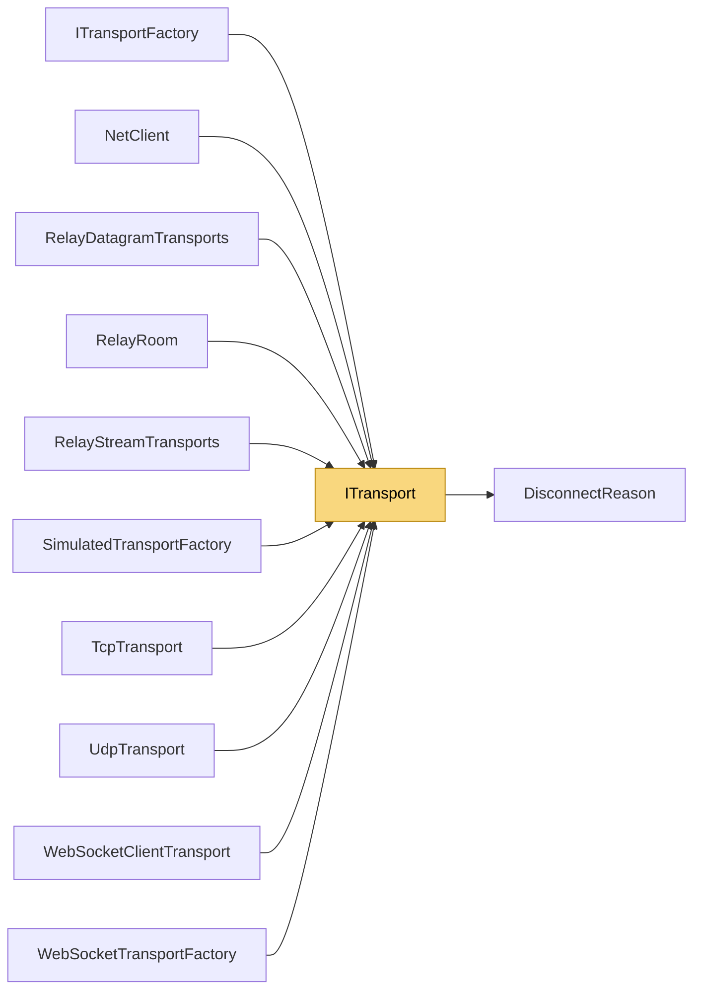

# ITransport

> [!NOTE]
> Generated by `tools/generate-vault.py` from the source — do not edit by hand; rerun the script after code changes.

Client-side transport: a single link to a remote server. Threading contract: all events are raised on background network threads. Never block inside a handler; hand data off to your own queue if you need main-thread delivery (the Unity adapter does exactly that). Lifetime contract: a transport instance is reusable — after Disconnect() completes it may be connected again with ConnectAsync().

**Namespace** `NetSync.Transports` · **Folder** [Transports](../../4%20Diagrams/Modules/Module%20map%20Transports.md) · **Layer** Transports

**Source** `src/NetSync/Transports/ITransport.cs`

## Types

| Type | Kind | Summary |
|---|---|---|
| `ITransport` | public interface | Client-side transport: a single link to a remote server. Threading contract: all events are raised on background network threads. Never block inside a handler; hand data off to your own queue if you need main-thread… |

## Extends / implements

- `ITransport` → `IDisposable`

## Depends on (1)

- **Transports**: [DisconnectReason](DisconnectReason.md)

## Used by (10)

- **Peers**: [NetClient](../Peers/NetClient.md)
- **Transports**: [ITransportFactory](ITransportFactory.md)
- **Transports/Tcp**: [TcpTransport](Tcp/TcpTransport.md)
- **Transports/Udp**: [UdpTransport](Udp/UdpTransport.md)
- **Transports/WebSockets**: [WebSocketClientTransport](WebSockets/WebSocketClientTransport.md), [WebSocketTransportFactory](WebSockets/WebSocketTransportFactory.md)
- **Transports/Simulation**: [SimulatedTransportFactory](Simulation/SimulatedTransportFactory.md)
- **Relay**: [RelayDatagramTransports](../Relay/RelayDatagramTransports.md), [RelayRoom](../Relay/RelayRoom.md), [RelayStreamTransports](../Relay/RelayStreamTransports.md)

## Neighbourhood

