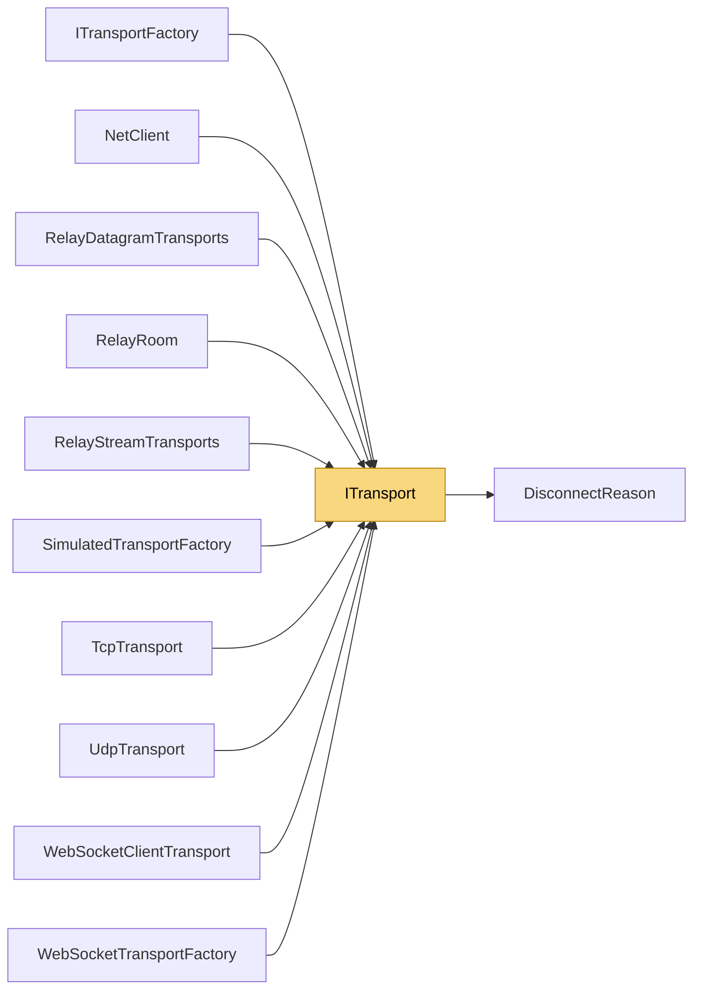

# ITransport

> [!info] Generated by `tools/generate-vault.py` from the source — do not edit by hand; rerun the script after code changes.

Client-side transport: a single link to a remote server. Threading contract: all events are raised on background network threads. Never block inside a handler; hand data off to your own queue if you need main-thread delivery (the Unity adapter does exactly that). Lifetime contract: a transport instance is reusable — after Disconnect() completes it may be connected again with ConnectAsync().

**Namespace** `NetSync.Transports` · **Folder** [[Module map Transports|Transports]] · **Layer** Transports

**Source** `src/NetSync/Transports/ITransport.cs`

## Types

| Type | Kind | Summary |
|---|---|---|
| `ITransport` | public interface | Client-side transport: a single link to a remote server. Threading contract: all events are raised on background network threads. Never block inside a handler; hand data off to your own queue if you need main-thread… |

## Extends / implements

- `ITransport` → `IDisposable`

## Depends on (1)

- **Transports**: [[DisconnectReason]]

## Used by (10)

- **Peers**: [[NetClient]]
- **Transports**: [[ITransportFactory]]
- **Transports/Tcp**: [[TcpTransport]]
- **Transports/Udp**: [[UdpTransport]]
- **Transports/WebSockets**: [[WebSocketClientTransport]], [[WebSocketTransportFactory]]
- **Transports/Simulation**: [[SimulatedTransportFactory]]
- **Relay**: [[RelayDatagramTransports]], [[RelayRoom]], [[RelayStreamTransports]]

## Neighbourhood

