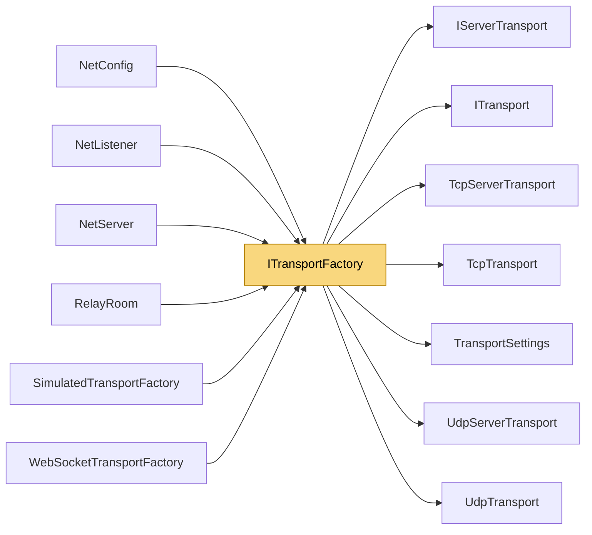

# ITransportFactory

> [!info] Generated by `tools/generate-vault.py` from the source — do not edit by hand; rerun the script after code changes.

Creates the implementation behind a transport slot. Register a factory in `TransportFactories` to run NetSync over your own transport (WebSocket, a platform socket API, an in-memory test network, …) — channels, handshake, reliability, compression and encryption all work on top unchanged. Slot contracts: - `Tcp`: messages arrive reliably, in order, as sent. - `Udp`: messages are datagrams — may be lost, duplicated or reordered; NetSync's reliability layer runs on top. Every implementation must preserve message boundaries (one SendAsync = one DataReceived on the other side) and raise events on a single thread per link.

**Namespace** `NetSync.Transports` · **Folder** [[Module map Transports|Transports]] · **Layer** Transports

**Source** `src/NetSync/Transports/ITransportFactory.cs`

## Types

| Type | Kind | Summary |
|---|---|---|
| `ITransportFactory` | public interface | Creates the implementation behind a transport slot. Register a factory in `TransportFactories` to run NetSync over your own transport (WebSocket, a platform socket API, an in-memory test network, …) — channels,… |
| `TcpTransportFactory` | public sealed class | The built-in TCP implementation (default for the Tcp slot). |
| `UdpTransportFactory` | public sealed class | The built-in UDP implementation (default for the Udp slot). |

## Extends / implements

- `TcpTransportFactory` → `ITransportFactory`
- `UdpTransportFactory` → `ITransportFactory`

## Members

**TcpTransportFactory**

- `public static readonly TcpTransportFactory Instance = new TcpTransportFactory()`
- `public ITransport CreateClient(TransportSettings settings)`
- `public IServerTransport CreateServer(TransportSettings settings)`

**UdpTransportFactory**

- `public static readonly UdpTransportFactory Instance = new UdpTransportFactory()`
- `public ITransport CreateClient(TransportSettings settings)`
- `public IServerTransport CreateServer(TransportSettings settings)`

## Depends on (7)

- **Transports**: [[IServerTransport]], [[ITransport]], [[TransportSettings]]
- **Transports/Tcp**: [[TcpServerTransport]], [[TcpTransport]]
- **Transports/Udp**: [[UdpServerTransport]], [[UdpTransport]]

## Used by (6)

- **(root)**: [[NetConfig]] (`ITransportFactory`, `TcpTransportFactory`, `UdpTransportFactory`)
- **Peers**: [[NetListener]], [[NetServer]]
- **Transports/WebSockets**: [[WebSocketTransportFactory]]
- **Transports/Simulation**: [[SimulatedTransportFactory]]
- **Relay**: [[RelayRoom]]

## Neighbourhood

