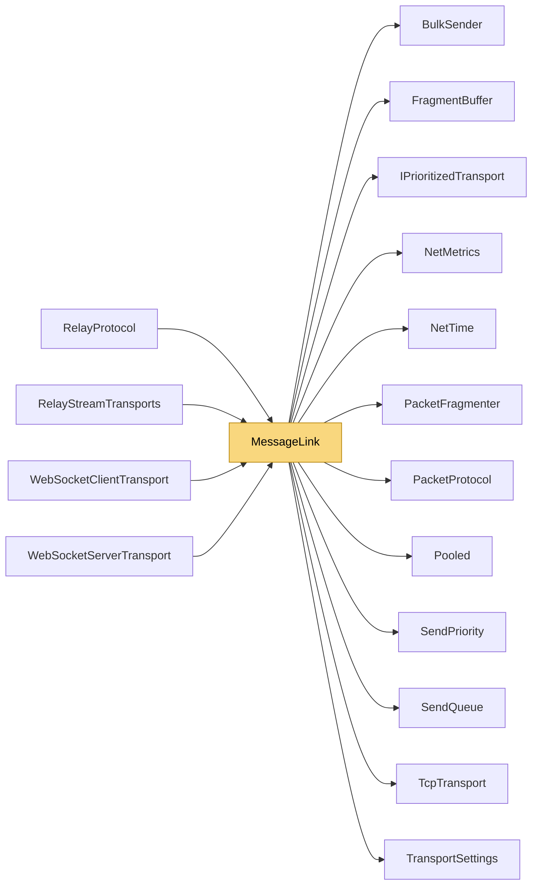

# MessageLink

> [!info] Generated by `tools/generate-vault.py` from the source — do not edit by hand; rerun the script after code changes.

NetSync packets over any reliable, message-preserving pipe (a WebSocket, a relay tunnel): [type:1][payload] per message — Ping, Pong, Data — with a priority send queue, keepalive bookkeeping, fragmentation of large messages and bounded reassembly. The pipe only has to write one message at a time and hand complete messages in.

**Namespace** `NetSync.Transports` · **Folder** [[Module map Transports|Transports]] · **Layer** Transports

**Source** `src/NetSync/Transports/MessageLink.cs`

## Types

| Type | Kind | Summary |
|---|---|---|
| `MessageLink` | internal sealed class | NetSync packets over any reliable, message-preserving pipe (a WebSocket, a relay tunnel): [type:1][payload] per message — Ping, Pong, Data — with a priority send queue, keepalive bookkeeping, fragmentation of large… |

## Extends / implements

- `MessageLink` → `IDisposable`

## Members

**MessageLink**

- `public const int MaxMessage = 1 + PacketProtocol.MaxTcpFrameBody + 64`
- `public readonly SendQueue SendQueue`
- `public readonly NetMetrics Metrics = new NetMetrics()`
- `public MessageLink(Func<byte[], int, CancellationToken, ValueTask> writeMessage, TransportSettings settings)`
- `public int PingMs`
- `public long LastPongAtMs`
- `public void Start()`
- `public ValueTask SendAsync(ReadOnlyMemory<byte> prefix, ReadOnlyMemory<byte> payload, SendPriority priority, CancellationToken ct)`
- `public void SendPing()`
- `public bool HandleMessage(byte[] buffer, int offset, int length, Action<byte[], int, int> deliver)`
- `public string? CheckHealth(TransportSettings settings, bool expectPongs)`
- `public void Dispose()`

## Depends on (12)

- **Transports**: [[BulkSender]], [[IPrioritizedTransport]] (`PriorityMapping`), [[PacketProtocol]] (`PacketProtocol`, `PacketType`), [[TransportSettings]]
- **Transports/Tcp**: [[TcpTransport]]
- **Sending**: [[SendPriority]], [[SendQueue]]
- **Pipeline/Fragmentation**: [[FragmentBuffer]], [[PacketFragmenter]]
- **Diagnostics**: [[NetMetrics]]
- **Internal**: [[NetTime]], [[Pooled]]

## Used by (4)

- **Transports/WebSockets**: [[WebSocketClientTransport]], [[WebSocketServerTransport]]
- **Relay**: [[RelayProtocol]], [[RelayStreamTransports]]

## Neighbourhood

