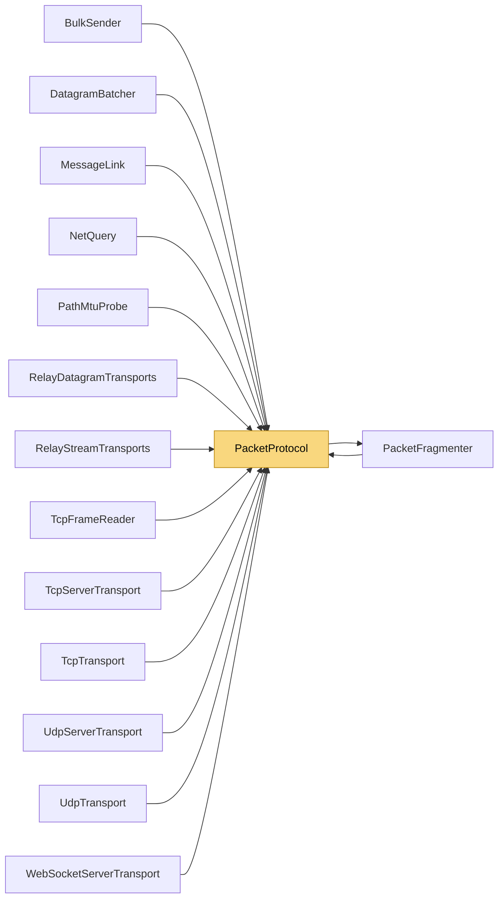

# PacketProtocol

> [!info] Generated by `tools/generate-vault.py` from the source — do not edit by hand; rerun the script after code changes.

Wire format helpers. UDP datagram: [type:1][payload] TCP frame: [type:1][length:4 BE][payload] (Ping/Pong: [type:1][timestamp:8 BE]) Frame builders write into `ArrayPool{T}` buffers: the hot send path allocates nothing. Every Rent* result must go back via `Return`. Rented arrays are usually longer than requested — always pair them with the out length, never use buffer.Length.

**Namespace** `NetSync.Transports` · **Folder** [[Module map Transports|Transports]] · **Layer** Transports

**Source** `src/NetSync/Transports/PacketProtocol.cs`

## Types

| Type | Kind | Summary |
|---|---|---|
| `PacketType` | internal enum |  |
| `PacketProtocol` | internal static class | Wire format helpers. UDP datagram: [type:1][payload] TCP frame: [type:1][length:4 BE][payload] (Ping/Pong: [type:1][timestamp:8 BE]) Frame builders write into `ArrayPool{T}` buffers: the hot send path allocates… |

## Members

**PacketProtocol**

- `public const int TcpHeaderSize = 5`
- `public const int PingPacketSize = 9`
- `public const int MaxTcpFrameBody = Pipeline.Fragmentation.PacketFragmenter.MaxUnfragmentedSize`
- `public const int MaxUntrustedFrameBody = 1024`
- `public static void Return(byte[] buffer)`
- `public static byte[] RentPingPacket(long timestampMs)`
- `public static byte[] RentPongPacket(long echoedTimestampMs)`
- `public static long ReadTimestamp(ReadOnlySpan<byte> packet)`
- `public static byte[] RentUdpDataPacket(ReadOnlySpan<byte> prefix, ReadOnlySpan<byte> payload, out int length)`
- `public static byte[] RentTcpDataFrame(ReadOnlySpan<byte> prefix, ReadOnlySpan<byte> payload, out int length)`
- `public static byte[] RentTcpFragmentFrame(uint sequenceId, uint index, uint total, ReadOnlySpan<byte> chunk, out int length)`
- `public static byte[] RentTcpFragmentFrame(uint sequenceId, uint index, uint total,`
- `public static byte[] RentMessageFragment(uint sequenceId, uint index, uint total,`
- `public static void CopyRange(ReadOnlySpan<byte> first, ReadOnlySpan<byte> second, int offset, Span<byte> dest)`
- `public static int ReadTcpFrameLength(ReadOnlySpan<byte> header)`

## Depends on (1)

- **Pipeline/Fragmentation**: [[PacketFragmenter]]

## Used by (14)

- **Discovery**: [[NetQuery]] (`PacketType`)
- **Transports**: [[BulkSender]], [[MessageLink]] (`PacketProtocol`, `PacketType`)
- **Transports/Tcp**: [[TcpFrameReader]] (`PacketProtocol`, `PacketType`), [[TcpServerTransport]], [[TcpTransport]]
- **Transports/Udp**: [[DatagramBatcher]] (`PacketType`), [[PathMtuProbe]] (`PacketType`), [[UdpServerTransport]] (`PacketProtocol`, `PacketType`), [[UdpTransport]] (`PacketProtocol`, `PacketType`)
- **Transports/WebSockets**: [[WebSocketServerTransport]]
- **Relay**: [[RelayDatagramTransports]] (`PacketProtocol`, `PacketType`), [[RelayStreamTransports]]
- **Pipeline/Fragmentation**: [[PacketFragmenter]] (`PacketType`)

## Neighbourhood

