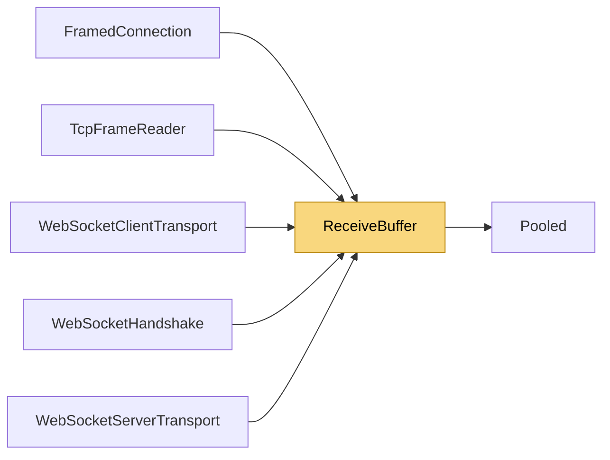

# ReceiveBuffer

> [!info] Generated by `tools/generate-vault.py` from the source — do not edit by hand; rerun the script after code changes.

A connection's receive buffer that is small while traffic is small. It starts at `SmallSize` — enough for many small frames per socket read — grows only when a frame bigger than that actually arrives (up to the frame limit), and drops back once it is empty again. An idle connection holds kilobytes, not the worst case: a server with ten thousand clients doesn't pay for ten thousand 64 KB frames it never sees.

**Namespace** `NetSync.Transports` · **Folder** [[Module map Transports|Transports]] · **Layer** Transports

**Source** `src/NetSync/Transports/ReceiveBuffer.cs`

## Types

| Type | Kind | Summary |
|---|---|---|
| `ReceiveBuffer` | internal sealed class | A connection's receive buffer that is small while traffic is small. It starts at `SmallSize` — enough for many small frames per socket read — grows only when a frame bigger than that actually arrives (up to the frame… |

## Extends / implements

- `ReceiveBuffer` → `IDisposable`

## Members

**ReceiveBuffer**

- `public const int SmallSize = 8 * 1024`
- `public byte[] Array`
- `public int Start`
- `public int Available`
- `public void Consume(int count)`
- `public Memory<byte> GetReadMemory(int pendingFrameSize)`
- `public void Advance(int bytesRead)`
- `public void Dispose()`

## Depends on (1)

- **Internal**: [[Pooled]]

## Used by (5)

- **Transports/Tcp**: [[TcpFrameReader]]
- **Transports/WebSockets**: [[WebSocketClientTransport]], [[WebSocketHandshake]], [[WebSocketServerTransport]]
- **Relay**: [[FramedConnection]]

## Neighbourhood

