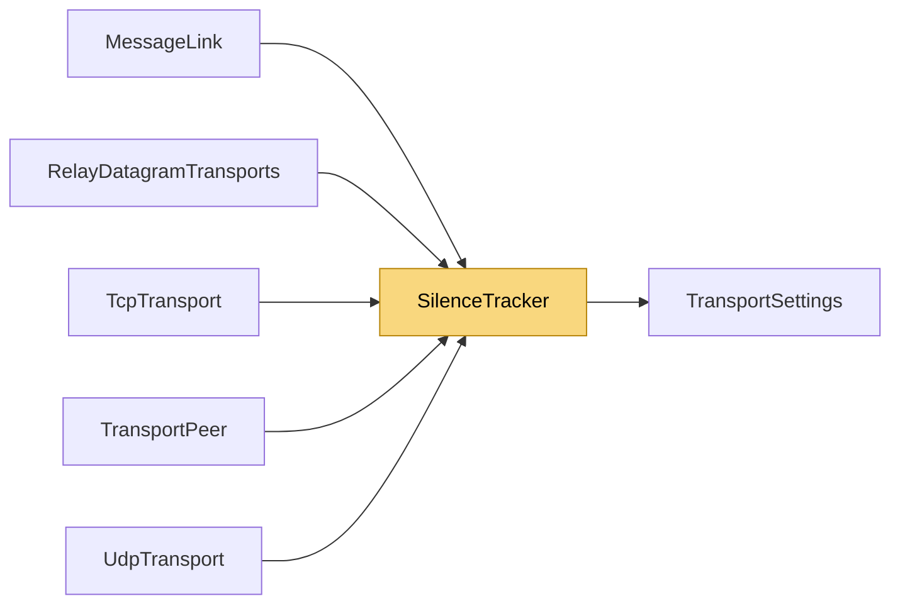

# SilenceTracker

> [!info] Generated by `tools/generate-vault.py` from the source — do not edit by hand; rerun the script after code changes.

Decides when a link has been silent long enough to call it dead. Silence is counted in keepalive rounds this process actually ran, not only in elapsed time: while our own process is paused (a busy machine, a starved thread pool, a laptop waking up) we send no pings, so the peer can't answer them — the silence is ours, not the peer's. A link is dead when enough rounds in a row heard nothing (PingTimeoutMs / PingIntervalMs of them) and the timeout has also passed. Owned by one keepalive loop; not thread-safe.

**Namespace** `NetSync.Transports` · **Folder** [[Module map Transports|Transports]] · **Layer** Transports

**Source** `src/NetSync/Transports/SilenceTracker.cs`

## Types

| Type | Kind | Summary |
|---|---|---|
| `SilenceTracker` | internal struct | Decides when a link has been silent long enough to call it dead. Silence is counted in keepalive rounds this process actually ran, not only in elapsed time: while our own process is paused (a busy machine, a starved… |

## Members

**SilenceTracker**

- `public bool IsDead(long lastHeardMs, long nowMs, TransportSettings settings)`

## Depends on (1)

- **Transports**: [[TransportSettings]]

## Used by (5)

- **Transports**: [[MessageLink]], [[TransportPeer]]
- **Transports/Tcp**: [[TcpTransport]]
- **Transports/Udp**: [[UdpTransport]]
- **Relay**: [[RelayDatagramTransports]]

## Neighbourhood

