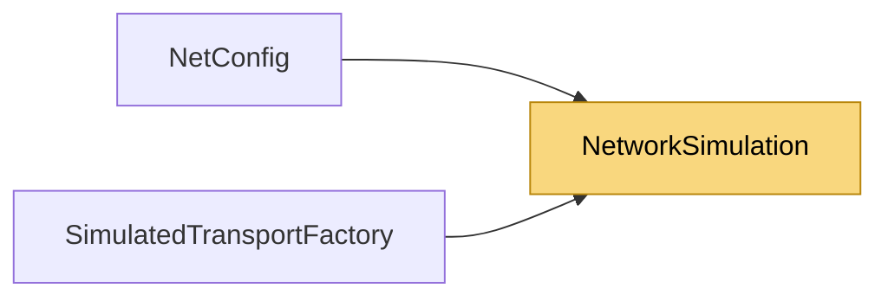

# NetworkSimulation

> [!info] Generated by `tools/generate-vault.py` from the source — do not edit by hand; rerun the script after code changes.

A bad network, on demand — for development and testing only. Set `Simulation` on one peer (typically the client) to see how the application behaves with lag, jitter and loss, without touching the real network. Applies to every packet this peer sends and receives: latency and jitter are added in each direction (the round trip grows by 2 × `LatencyMs`); loss and duplication hit datagram (UDP-slot) links only — stream links stay reliable and ordered, as TCP is.

**Namespace** `NetSync.Transports.Simulation` · **Folder** [[Module map Transports Simulation|Transports/Simulation]] · **Layer** Transports

**Source** `src/NetSync/Transports/Simulation/NetworkSimulation.cs`

## Types

| Type | Kind | Summary |
|---|---|---|
| `NetworkSimulation` | public sealed class | A bad network, on demand — for development and testing only. Set `Simulation` on one peer (typically the client) to see how the application behaves with lag, jitter and loss, without touching the real network.… |

## Members

**NetworkSimulation**

- `public int LatencyMs`
- `public int JitterMs`
- `public double LossRate`
- `public double DuplicateRate`
- `public int? Seed`

## Depends on (0)

—

## Used by (2)

- **(root)**: [[NetConfig]]
- **Transports/Simulation**: [[SimulatedTransportFactory]]

## Neighbourhood

