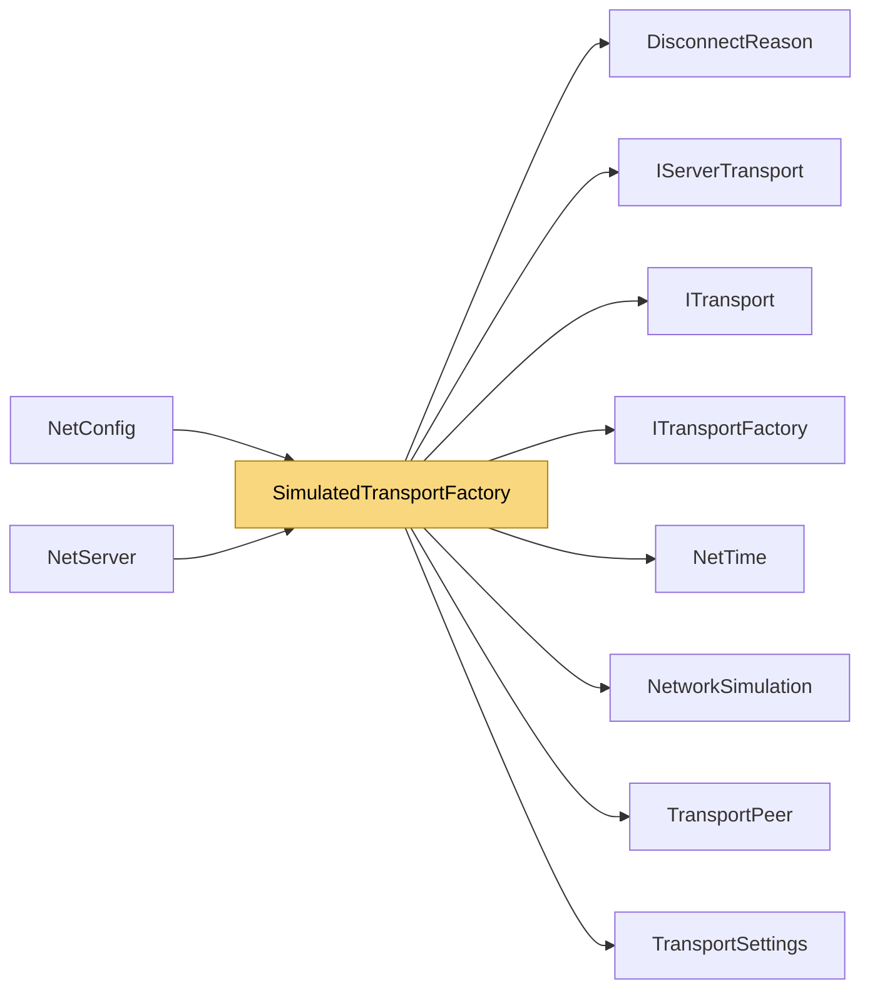

# SimulatedTransportFactory

> [!info] Generated by `tools/generate-vault.py` from the source — do not edit by hand; rerun the script after code changes.

Wraps any transport factory with a `NetworkSimulation`. NetSync applies it automatically when `Simulation` is set; use it directly to simulate only one slot or a custom transport.

**Namespace** `NetSync.Transports.Simulation` · **Folder** [[Module map Transports Simulation|Transports/Simulation]] · **Layer** Transports

**Source** `src/NetSync/Transports/Simulation/SimulatedTransportFactory.cs`

## Types

| Type | Kind | Summary |
|---|---|---|
| `SimulatedTransportFactory` | public sealed class | Wraps any transport factory with a `NetworkSimulation`. NetSync applies it automatically when `Simulation` is set; use it directly to simulate only one slot or a custom transport. |
| `IWrappedServerTransport` | internal interface | Lets the peer layer reach the real transport behind a wrapper (trust mode, hooks). |
| `Impairment` | internal sealed class | Decides each packet's fate: dropped, or delivered (maybe twice) at some time. |
| `SimulationClock` | internal static class | One background thread delivering delayed packets on time. Waits coarsely and spins the last stretch: OS timers (15.6 ms on Windows) would distort small latencies. |
| ↳ `Item` | private struct |  |
| `SimulatedClientTransport` | internal sealed class |  |
| `SimulatedServerTransport` | internal sealed class |  |

## Extends / implements

- `SimulatedTransportFactory` → `ITransportFactory` ([[ITransportFactory]])
- `SimulatedClientTransport` → `ITransport` ([[ITransport]])
- `SimulatedServerTransport` → `IServerTransport` ([[IServerTransport]])
- `SimulatedServerTransport` → `IWrappedServerTransport`

## Members

**SimulatedTransportFactory**

- `public SimulatedTransportFactory(ITransportFactory inner, NetworkSimulation simulation, bool datagram)`
- `public ITransport CreateClient(TransportSettings settings)`
- `public IServerTransport CreateServer(TransportSettings settings)`

**Impairment**

- `public Impairment(NetworkSimulation simulation, bool datagram)`
- `public int ExtraRoundTripMs`
- `public Impairment ForOtherDirection()`
- `public void Apply(Action deliver)`

**SimulationClock**

- `public static void Schedule(double dueMs, Action action)`

**SimulatedClientTransport**

- `public SimulatedClientTransport(ITransport inner, Impairment impairment)`
- `public bool IsConnected`
- `public int PingMs`
- `public event Action? Connected`
- `public event Action<DisconnectReason>? Disconnected`
- `public event Action<byte[]>? DataReceived`
- `public Task ConnectAsync(IPEndPoint endpoint, CancellationToken ct = default)`
- `public ValueTask SendAsync(ReadOnlyMemory<byte> data, CancellationToken ct = default)`
- `public ValueTask SendAsync(ReadOnlyMemory<byte> prefix, ReadOnlyMemory<byte> payload, CancellationToken ct = default)`
- `public void Disconnect()`
- `public void Dispose()`

**SimulatedServerTransport**

- `public SimulatedServerTransport(IServerTransport inner, Impairment impairment)`
- `public IServerTransport Inner`
- `public int Port`
- `public bool IsRunning`
- `public event Action<TransportPeer>? PeerConnected`
- `public event Action<TransportPeer, DisconnectReason>? PeerDisconnected`
- `public event Action<TransportPeer, byte[]>? DataReceived`
- `public Task<int> StartAsync(int port, CancellationToken ct = default)`
- `public Task StopAsync()`
- `public ValueTask SendAsync(TransportPeer peer, ReadOnlyMemory<byte> data, CancellationToken ct = default)`
- `public ValueTask SendAsync(TransportPeer peer, ReadOnlyMemory<byte> prefix, ReadOnlyMemory<byte> payload, CancellationToken ct = default)`
- `public void DisconnectPeer(TransportPeer peer)`
- `public void Dispose()`

## Depends on (8)

- **Transports**: [[DisconnectReason]], [[IServerTransport]], [[ITransport]], [[ITransportFactory]], [[TransportPeer]], [[TransportSettings]]
- **Transports/Simulation**: [[NetworkSimulation]]
- **Internal**: [[NetTime]]

## Used by (2)

- **(root)**: [[NetConfig]]
- **Peers**: [[NetServer]] (`IWrappedServerTransport`, `SimulatedTransportFactory`)

## Neighbourhood

