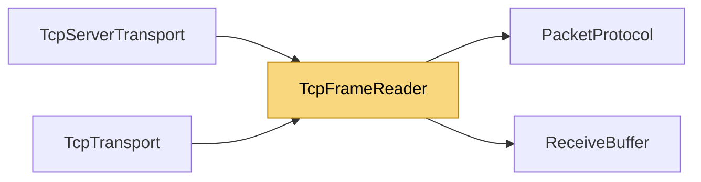

# TcpFrameReader

> [!info] Generated by `tools/generate-vault.py` from the source — do not edit by hand; rerun the script after code changes.

Incremental TCP frame parser over a `ReceiveBuffer`. A single socket read usually brings in many small frames; they are parsed and delivered straight from the buffer — no per-frame reads, no per-frame copies — and the buffer only grows while a large frame is in flight. Usage: read into `GetReadMemory`, call `Advance`, then `TryRead` until it returns `None`. A Data frame's bytes stay valid until the next `GetReadMemory`.

**Namespace** `NetSync.Transports.Tcp` · **Folder** [[Module map Transports Tcp|Transports/Tcp]] · **Layer** Transports

**Source** `src/NetSync/Transports/Tcp/TcpFrameReader.cs`

## Types

| Type | Kind | Summary |
|---|---|---|
| `TcpFrameReader` | internal sealed class | Incremental TCP frame parser over a `ReceiveBuffer`. A single socket read usually brings in many small frames; they are parsed and delivered straight from the buffer — no per-frame reads, no per-frame copies — and… |
| ↳ `FrameKind` | public enum |  |

## Extends / implements

- `TcpFrameReader` → `IDisposable`

## Members

**TcpFrameReader**

- `public byte[] Buffer`
- `public Memory<byte> GetReadMemory()`
- `public void Advance(int bytesRead)`
- `public FrameKind TryRead(int maxBody, out int offset, out int length, out long timestamp)`
- `public void Dispose()`

## Depends on (2)

- **Transports**: [[PacketProtocol]] (`PacketProtocol`, `PacketType`), [[ReceiveBuffer]]

## Used by (2)

- **Transports/Tcp**: [[TcpServerTransport]], [[TcpTransport]]

## Neighbourhood

