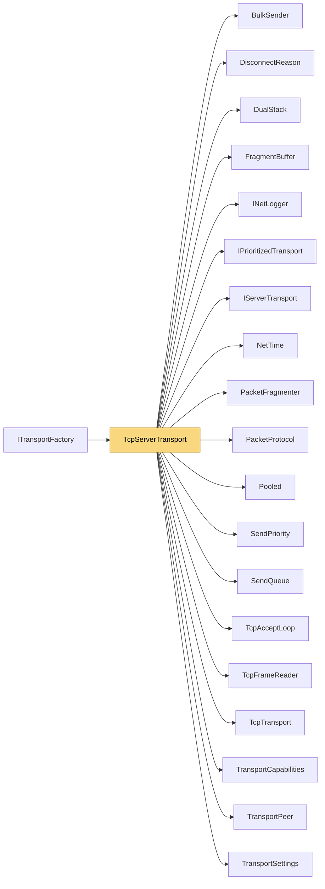

# TcpServerTransport

> [!NOTE]
> Generated by `tools/generate-vault.py` from the source — do not edit by hand; rerun the script after code changes.

Server-side TCP transport: accepts clients, frames packets, pings peers and drops the ones that stop answering. Every peer gets its own priority `SendQueue`: sends never block the caller on a slow client, keepalive jumps ahead of bulk data, and a client that stops reading is detected by the write watchdog instead of hanging the server.

**Namespace** `NetSync.Transports.Tcp` · **Folder** [Transports/Tcp](../../../4%20Diagrams/Modules/Module%20map%20Transports%20Tcp.md) · **Layer** Transports

**Source** `src/NetSync/Transports/Tcp/TcpServerTransport.cs`

## Types

| Type | Kind | Summary |
|---|---|---|
| `TcpServerTransport` | public sealed class | Server-side TCP transport: accepts clients, frames packets, pings peers and drops the ones that stop answering. Every peer gets its own priority `SendQueue`: sends never block the caller on a slow client, keepalive… |
| ↳ `PeerState` | private sealed class |  |

## Extends / implements

- `TcpServerTransport` → `IServerTransport` ([IServerTransport](../IServerTransport.md))
- `TcpServerTransport` → `IPeerFlushingServerTransport` ([TransportCapabilities](../TransportCapabilities.md))
- `TcpServerTransport` → `IPrioritizedServerTransport` ([IPrioritizedTransport](../IPrioritizedTransport.md))
- `TcpServerTransport` → `IPooledReceiveServerTransport` ([TransportCapabilities](../TransportCapabilities.md))
- `TcpServerTransport` → `ITrustAwareServerTransport` ([TransportCapabilities](../TransportCapabilities.md))

## Members

**TcpServerTransport**

- `public int Port`
- `public bool IsRunning`
- `public event Action<TransportPeer>? PeerConnected`
- `public event Action<TransportPeer, DisconnectReason>? PeerDisconnected`
- `public event Action<TransportPeer, byte[]>? DataReceived`
- `internal Action<TransportPeer, byte[], int, int>? PooledReceive`
- `internal bool RequireTrust`
- `public TcpServerTransport(int pingIntervalMs = 1000, int pingTimeoutMs = 5000, INetLogger? logger = null)`
- `public TcpServerTransport(TransportSettings settings)`
- `public Task<int> StartAsync(int port, CancellationToken ct = default)`
- `public ValueTask SendAsync(TransportPeer peer, ReadOnlyMemory<byte> data, CancellationToken ct = default)`
- `public ValueTask SendAsync(TransportPeer peer, ReadOnlyMemory<byte> prefix, ReadOnlyMemory<byte> payload, CancellationToken ct = default)`
- `public ValueTask SendAsync(TransportPeer peer, ReadOnlyMemory<byte> prefix, ReadOnlyMemory<byte> payload, SendPriority priority, CancellationToken ct = default)`
- `public void DisconnectPeer(TransportPeer peer)`
- `public async Task StopAsync()`
- `public void Dispose()`

## Depends on (19)

- **Transports**: [BulkSender](../BulkSender.md), [DisconnectReason](../DisconnectReason.md), [DualStack](../DualStack.md), [IPrioritizedTransport](../IPrioritizedTransport.md) (`IPrioritizedServerTransport`, `PriorityMapping`), [IServerTransport](../IServerTransport.md), [PacketProtocol](../PacketProtocol.md), [TcpAcceptLoop](../TcpAcceptLoop.md), [TransportCapabilities](../TransportCapabilities.md) (`IPeerFlushingServerTransport`, `IPooledReceiveServerTransport`, `ITrustAwareServerTransport`, `ReceivedPacket`), [TransportPeer](../TransportPeer.md), [TransportSettings](../TransportSettings.md)
- **Transports/Tcp**: [TcpFrameReader](TcpFrameReader.md), [TcpTransport](TcpTransport.md)
- **Sending**: [SendPriority](../../Sending/SendPriority.md), [SendQueue](../../Sending/SendQueue.md)
- **Pipeline/Fragmentation**: [FragmentBuffer](../../Pipeline/Fragmentation/FragmentBuffer.md), [PacketFragmenter](../../Pipeline/Fragmentation/PacketFragmenter.md)
- **Diagnostics**: [INetLogger](../../Diagnostics/INetLogger.md)
- **Internal**: [NetTime](../../Internal/NetTime.md), [Pooled](../../Internal/Pooled.md)

## Used by (1)

- **Transports**: [ITransportFactory](../ITransportFactory.md)

## Neighbourhood

