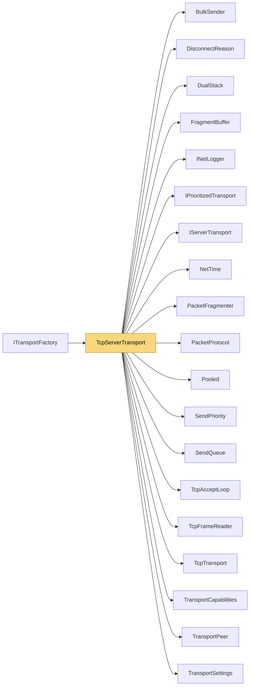

# TcpServerTransport

> [!info] Generated by `tools/generate-vault.py` from the source — do not edit by hand; rerun the script after code changes.

Server-side TCP transport: accepts clients, frames packets, pings peers and drops the ones that stop answering. Every peer gets its own priority `SendQueue`: sends never block the caller on a slow client, keepalive jumps ahead of bulk data, and a client that stops reading is detected by the write watchdog instead of hanging the server.

**Namespace** `NetSync.Transports.Tcp` · **Folder** [[Module map Transports Tcp|Transports/Tcp]] · **Layer** Transports

**Source** `src/NetSync/Transports/Tcp/TcpServerTransport.cs`

## Types

| Type | Kind | Summary |
|---|---|---|
| `TcpServerTransport` | public sealed class | Server-side TCP transport: accepts clients, frames packets, pings peers and drops the ones that stop answering. Every peer gets its own priority `SendQueue`: sends never block the caller on a slow client, keepalive… |
| ↳ `PeerState` | private sealed class |  |

## Extends / implements

- `TcpServerTransport` → `IServerTransport` ([[IServerTransport]])
- `TcpServerTransport` → `IPrioritizedServerTransport` ([[IPrioritizedTransport]])
- `TcpServerTransport` → `IPooledReceiveServerTransport` ([[TransportCapabilities]])
- `TcpServerTransport` → `ITrustAwareServerTransport` ([[TransportCapabilities]])

## Members

**TcpServerTransport**

- `public int Port`
- `public bool IsRunning`
- `public event Action<TransportPeer>? PeerConnected`
- `public event Action<TransportPeer, DisconnectReason>? PeerDisconnected`
- `public event Action<TransportPeer, byte[]>? DataReceived`
- `internal Action<TransportPeer, byte[], int, int>? PooledReceive`
- `internal bool RequireTrust`
- `public TcpServerTransport(int pingIntervalMs = 1000, int pingTimeoutMs = 5000, INetLogger? logger = null)`
- `public TcpServerTransport(TransportSettings settings)`
- `public Task<int> StartAsync(int port, CancellationToken ct = default)`
- `public ValueTask SendAsync(TransportPeer peer, ReadOnlyMemory<byte> data, CancellationToken ct = default)`
- `public ValueTask SendAsync(TransportPeer peer, ReadOnlyMemory<byte> prefix, ReadOnlyMemory<byte> payload, CancellationToken ct = default)`
- `public ValueTask SendAsync(TransportPeer peer, ReadOnlyMemory<byte> prefix, ReadOnlyMemory<byte> payload, SendPriority priority, CancellationToken ct = default)`
- `public void DisconnectPeer(TransportPeer peer)`
- `public async Task StopAsync()`
- `public void Dispose()`

## Depends on (19)

- **Transports**: [[BulkSender]], [[DisconnectReason]], [[DualStack]], [[IPrioritizedTransport]] (`IPrioritizedServerTransport`, `PriorityMapping`), [[IServerTransport]], [[PacketProtocol]], [[TcpAcceptLoop]], [[TransportCapabilities]] (`IPooledReceiveServerTransport`, `ITrustAwareServerTransport`, `ReceivedPacket`), [[TransportPeer]], [[TransportSettings]]
- **Transports/Tcp**: [[TcpFrameReader]], [[TcpTransport]]
- **Sending**: [[SendPriority]], [[SendQueue]]
- **Pipeline/Fragmentation**: [[FragmentBuffer]], [[PacketFragmenter]]
- **Diagnostics**: [[INetLogger]]
- **Internal**: [[NetTime]], [[Pooled]]

## Used by (1)

- **Transports**: [[ITransportFactory]]

## Neighbourhood

