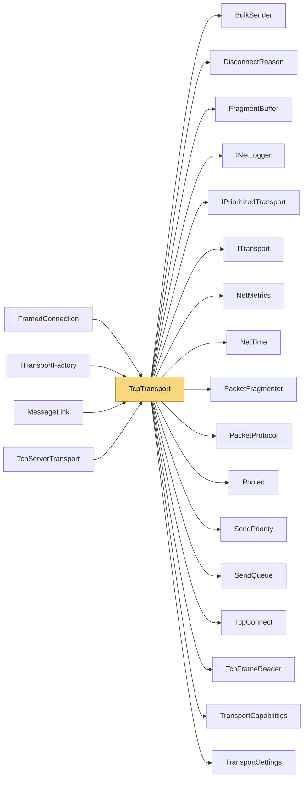

# TcpTransport

> [!info] Generated by `tools/generate-vault.py` from the source — do not edit by hand; rerun the script after code changes.

Client-side TCP transport. Frames packets, keeps the link alive with ping/pong, fragments large payloads so bulk data never blocks small real-time packets. Hot paths are allocation-free: frames are built in pooled buffers, coalesced into batched socket writes, and received through one pooled buffer that yields many frames per socket read. Hardened against a hostile or broken server: frame bodies above `MaxTcpFrameBody` and reassembled messages above `MaxMessageSize` close the link instead of allocating; a write stuck longer than `WriteTimeoutMs` closes it with `Timeout`. Reusable: each ConnectAsync builds a fresh connection state.

**Namespace** `NetSync.Transports.Tcp` · **Folder** [[Module map Transports Tcp|Transports/Tcp]] · **Layer** Transports

**Source** `src/NetSync/Transports/Tcp/TcpTransport.cs`

## Types

| Type | Kind | Summary |
|---|---|---|
| `TcpTransport` | public sealed class | Client-side TCP transport. Frames packets, keeps the link alive with ping/pong, fragments large payloads so bulk data never blocks small real-time packets. Hot paths are allocation-free: frames are built in pooled… |
| ↳ `Connection` | private sealed class |  |

## Extends / implements

- `TcpTransport` → `ITransport` ([[ITransport]])
- `TcpTransport` → `IPrioritizedTransport` ([[IPrioritizedTransport]])
- `TcpTransport` → `IPooledReceiveTransport` ([[TransportCapabilities]])

## Members

**TcpTransport**

- `internal const int CoalesceBytes = 64 * 1024`
- `public bool IsConnected`
- `public int PingMs`
- `public NetMetrics? Metrics`
- `public event Action? Connected`
- `public event Action<DisconnectReason>? Disconnected`
- `public event Action<byte[]>? DataReceived`
- `internal Action<byte[], int, int>? PooledReceive`
- `public TcpTransport(int pingIntervalMs = 1000, int pingTimeoutMs = 5000, INetLogger? logger = null)`
- `public TcpTransport(TransportSettings settings)`
- `internal static FragmentBuffer CreateFragmentBuffer(int maxMessageSize)`
- `public async Task ConnectAsync(IPEndPoint endpoint, CancellationToken ct = default)`
- `public ValueTask SendAsync(ReadOnlyMemory<byte> data, CancellationToken ct = default)`
- `public ValueTask SendAsync(ReadOnlyMemory<byte> prefix, ReadOnlyMemory<byte> payload, CancellationToken ct = default)`
- `public ValueTask SendAsync(ReadOnlyMemory<byte> prefix, ReadOnlyMemory<byte> payload, SendPriority priority, CancellationToken ct = default)`
- `public void Disconnect()`
- `public void Dispose()`

## Depends on (17)

- **Transports**: [[BulkSender]], [[DisconnectReason]], [[IPrioritizedTransport]] (`IPrioritizedTransport`, `PriorityMapping`), [[ITransport]], [[PacketProtocol]], [[TcpConnect]], [[TransportCapabilities]] (`IPooledReceiveTransport`, `ReceivedPacket`), [[TransportSettings]]
- **Transports/Tcp**: [[TcpFrameReader]]
- **Sending**: [[SendPriority]], [[SendQueue]]
- **Pipeline/Fragmentation**: [[FragmentBuffer]], [[PacketFragmenter]]
- **Diagnostics**: [[INetLogger]], [[NetMetrics]]
- **Internal**: [[NetTime]], [[Pooled]]

## Used by (4)

- **Transports**: [[ITransportFactory]], [[MessageLink]]
- **Transports/Tcp**: [[TcpServerTransport]]
- **Relay**: [[FramedConnection]]

## Neighbourhood

