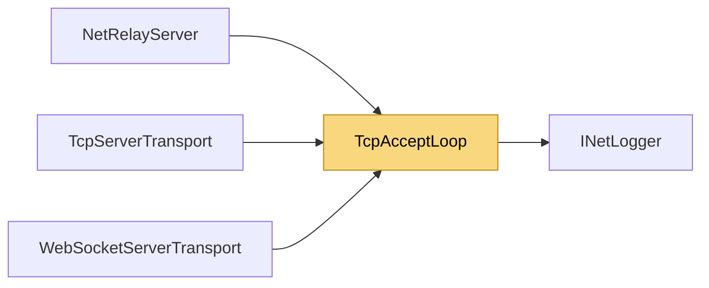

# TcpAcceptLoop

> [!info] Generated by `tools/generate-vault.py` from the source — do not edit by hand; rerun the script after code changes.

The accept loop of every TCP-based listener (TCP, WebSocket, relay). One misbehaving client never stops the listener: each is served on its own task, and a client whose setup throws (e.g. reset right after the accept) is closed and forgotten. Failing accepts (out of file descriptors…) back off instead of spinning.

**Namespace** `NetSync.Transports` · **Folder** [[Module map Transports|Transports]] · **Layer** Transports

**Source** `src/NetSync/Transports/TcpAcceptLoop.cs`

## Types

| Type | Kind | Summary |
|---|---|---|
| `TcpAcceptLoop` | internal static class | The accept loop of every TCP-based listener (TCP, WebSocket, relay). One misbehaving client never stops the listener: each is served on its own task, and a client whose setup throws (e.g. reset right after the… |

## Members

**TcpAcceptLoop**

- `public static async Task RunAsync(TcpListener listener, Func<TcpClient, Task> serve, INetLogger logger, string owner, CancellationToken ct)`

## Depends on (1)

- **Diagnostics**: [[INetLogger]]

## Used by (3)

- **Transports/Tcp**: [[TcpServerTransport]]
- **Transports/WebSockets**: [[WebSocketServerTransport]]
- **Relay**: [[NetRelayServer]]

## Neighbourhood

