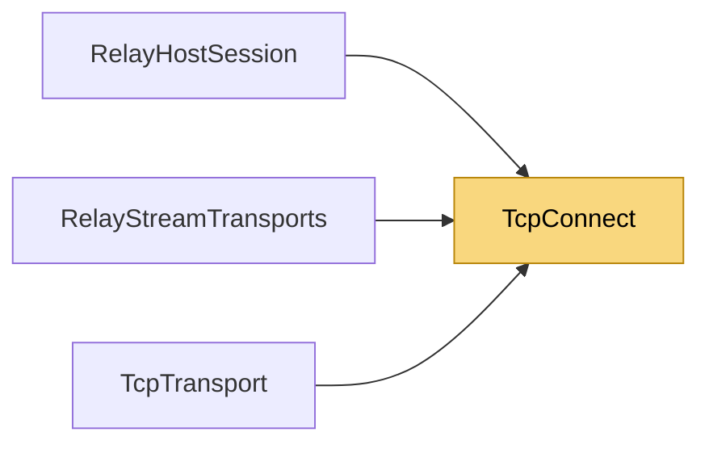

# TcpConnect

> [!info] Generated by `tools/generate-vault.py` from the source — do not edit by hand; rerun the script after code changes.

Outgoing TCP connects that honor cancellation on every target.

**Namespace** `NetSync.Transports` · **Folder** [[Module map Transports|Transports]] · **Layer** Transports

**Source** `src/NetSync/Transports/TcpConnect.cs`

## Types

| Type | Kind | Summary |
|---|---|---|
| `TcpConnect` | internal static class | Outgoing TCP connects that honor cancellation on every target. |

## Members

**TcpConnect**

- `public static async Task ConnectAsync(TcpClient client, IPEndPoint endpoint, CancellationToken ct)`

## Depends on (0)

—

## Used by (3)

- **Transports/Tcp**: [[TcpTransport]]
- **Relay**: [[RelayHostSession]], [[RelayStreamTransports]]

## Neighbourhood

