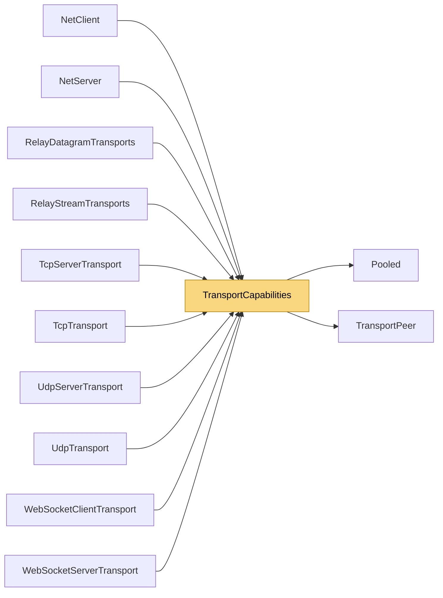

# TransportCapabilities

> [!info] Generated by `tools/generate-vault.py` from the source — do not edit by hand; rerun the script after code changes.

Zero-copy delivery for a client transport: the peer layer receives the transport's own (pooled) buffer, valid only during the call. When set, DataReceived is not raised. Built-in transports implement it; custom ones simply raise DataReceived.

**Namespace** `NetSync.Transports` · **Folder** [[Module map Transports|Transports]] · **Layer** Transports

**Source** `src/NetSync/Transports/TransportCapabilities.cs`

## Types

| Type | Kind | Summary |
|---|---|---|
| `IPooledReceiveTransport` | internal interface | Zero-copy delivery for a client transport: the peer layer receives the transport's own (pooled) buffer, valid only during the call. When set, DataReceived is not raised. Built-in transports implement it; custom ones… |
| `IPooledReceiveServerTransport` | internal interface | Server-side counterpart of `IPooledReceiveTransport`. |
| `IDatagramBoundaryTransport` | internal interface | A datagram transport that reports when it has handed over every packet of one received datagram (a batch carries several). The reliability layer acknowledges them with one ack per channel at that point instead of one… |
| `IDatagramBoundaryServerTransport` | internal interface | Server-side counterpart of `IDatagramBoundaryTransport`. |
| `ITrustAwareServerTransport` | internal interface | A server transport that can treat peers as potential attackers until the peer layer vouches for them: tiny message limit, no keepalive, bounded population. |
| `ReceivedPacket` | internal static class | How every built-in transport hands a received packet to the peer layer. |

## Members

**ReceivedPacket**

- `public static void Deliver(Action<byte[], int, int>? pooled, Action<byte[]>? copying, byte[] buffer, int offset, int count)`
- `public static void Deliver(Action<TransportPeer, byte[], int, int>? pooled, Action<TransportPeer, byte[]>? copying,`

## Depends on (2)

- **Transports**: [[TransportPeer]]
- **Internal**: [[Pooled]]

## Used by (10)

- **Peers**: [[NetClient]] (`IDatagramBoundaryTransport`, `IPooledReceiveTransport`), [[NetServer]] (`IDatagramBoundaryServerTransport`, `IPooledReceiveServerTransport`, `ITrustAwareServerTransport`)
- **Transports/Tcp**: [[TcpServerTransport]] (`IPooledReceiveServerTransport`, `ITrustAwareServerTransport`, `ReceivedPacket`), [[TcpTransport]] (`IPooledReceiveTransport`, `ReceivedPacket`)
- **Transports/Udp**: [[UdpServerTransport]] (`IDatagramBoundaryServerTransport`, `IPooledReceiveServerTransport`, `ITrustAwareServerTransport`, `ReceivedPacket`), [[UdpTransport]] (`IDatagramBoundaryTransport`, `IPooledReceiveTransport`, `ReceivedPacket`)
- **Transports/WebSockets**: [[WebSocketClientTransport]] (`IPooledReceiveTransport`, `ReceivedPacket`), [[WebSocketServerTransport]] (`IPooledReceiveServerTransport`, `ITrustAwareServerTransport`, `ReceivedPacket`)
- **Relay**: [[RelayDatagramTransports]] (`IPooledReceiveServerTransport`, `IPooledReceiveTransport`, `ITrustAwareServerTransport`, `ReceivedPacket`), [[RelayStreamTransports]] (`IPooledReceiveServerTransport`, `IPooledReceiveTransport`, `ITrustAwareServerTransport`, `ReceivedPacket`)

## Neighbourhood

