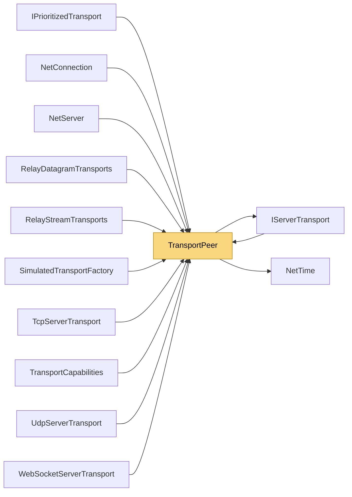

# TransportPeer

> [!info] Generated by `tools/generate-vault.py` from the source — do not edit by hand; rerun the script after code changes.

A remote peer as seen by a server transport. Transport-specific state stays inside the transport (`TransportState` is internal on purpose).

**Namespace** `NetSync.Transports` · **Folder** [[Module map Transports|Transports]] · **Layer** Transports

**Source** `src/NetSync/Transports/TransportPeer.cs`

## Types

| Type | Kind | Summary |
|---|---|---|
| `TransportPeer` | public sealed class | A remote peer as seen by a server transport. Transport-specific state stays inside the transport (`TransportState` is internal on purpose). |

## Members

**TransportPeer**

- `public long Id`
- `public IPEndPoint EndPoint`
- `public int PingMs`
- `internal object? TransportState`
- `internal object? SendState`
- `internal object? PeerLayerState`
- `internal IServerTransport? Owner`
- `internal bool IsTrusted`
- `internal void MarkTrusted()`
- `internal TransportPeer(IPEndPoint endPoint, long nowMs)`
- `public TransportPeer(IPEndPoint endPoint) : this(endPoint, Internal.NetTime.NowMs)`
- `public void ReportPing(int pingMs)`
- `internal void SetPing(int pingMs)`
- `internal void Touch(long nowMs)`
- `internal long LastSeenMs`
- `public override string ToString()`

## Depends on (2)

- **Transports**: [[IServerTransport]]
- **Internal**: [[NetTime]]

## Used by (11)

- **Peers**: [[NetConnection]], [[NetServer]]
- **Transports**: [[IPrioritizedTransport]], [[IServerTransport]], [[TransportCapabilities]]
- **Transports/Tcp**: [[TcpServerTransport]]
- **Transports/Udp**: [[UdpServerTransport]]
- **Transports/WebSockets**: [[WebSocketServerTransport]]
- **Transports/Simulation**: [[SimulatedTransportFactory]]
- **Relay**: [[RelayDatagramTransports]], [[RelayStreamTransports]]

## Neighbourhood

