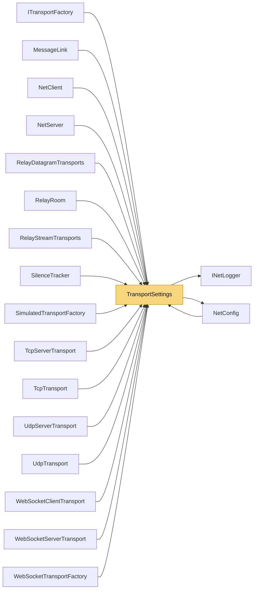

# TransportSettings

> [!NOTE]
> Generated by `tools/generate-vault.py` from the source — do not edit by hand; rerun the script after code changes.

Tuning shared by all built-in transports. `NetClient` and `NetServer` fill it from `NetConfig`.

**Namespace** `NetSync.Transports` · **Folder** [Transports](../../4%20Diagrams/Modules/Module%20map%20Transports.md) · **Layer** Transports

**Source** `src/NetSync/Transports/TransportSettings.cs`

## Types

| Type | Kind | Summary |
|---|---|---|
| `TransportSettings` | public sealed class | Tuning shared by all built-in transports. `NetClient` and `NetServer` fill it from `NetConfig`. |

## Members

**TransportSettings**

- `public int PingIntervalMs`
- `public int PingTimeoutMs`
- `public int WriteTimeoutMs`
- `public int MaxMessageSize`
- `public INetLogger Logger`
- `internal static TransportSettings From(int pingIntervalMs, int pingTimeoutMs, INetLogger? logger)`

## Depends on (2)

- **(root)**: [NetConfig](../Root/NetConfig.md)
- **Diagnostics**: [INetLogger](../Diagnostics/INetLogger.md) (`INetLogger`, `NullNetLogger`)

## Used by (17)

- **(root)**: [NetConfig](../Root/NetConfig.md)
- **Peers**: [NetClient](../Peers/NetClient.md), [NetServer](../Peers/NetServer.md)
- **Transports**: [ITransportFactory](ITransportFactory.md), [MessageLink](MessageLink.md), [SilenceTracker](SilenceTracker.md)
- **Transports/Tcp**: [TcpServerTransport](Tcp/TcpServerTransport.md), [TcpTransport](Tcp/TcpTransport.md)
- **Transports/Udp**: [UdpServerTransport](Udp/UdpServerTransport.md), [UdpTransport](Udp/UdpTransport.md)
- **Transports/WebSockets**: [WebSocketClientTransport](WebSockets/WebSocketClientTransport.md), [WebSocketServerTransport](WebSockets/WebSocketServerTransport.md), [WebSocketTransportFactory](WebSockets/WebSocketTransportFactory.md)
- **Transports/Simulation**: [SimulatedTransportFactory](Simulation/SimulatedTransportFactory.md)
- **Relay**: [RelayDatagramTransports](../Relay/RelayDatagramTransports.md), [RelayRoom](../Relay/RelayRoom.md), [RelayStreamTransports](../Relay/RelayStreamTransports.md)

## Neighbourhood

