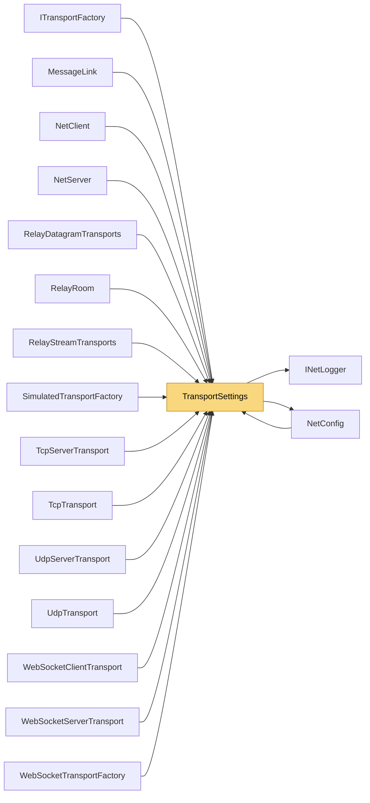

# TransportSettings

> [!info] Generated by `tools/generate-vault.py` from the source — do not edit by hand; rerun the script after code changes.

Tuning shared by all built-in transports. `NetClient` and `NetServer` fill it from `NetConfig`.

**Namespace** `NetSync.Transports` · **Folder** [[Module map Transports|Transports]] · **Layer** Transports

**Source** `src/NetSync/Transports/TransportSettings.cs`

## Types

| Type | Kind | Summary |
|---|---|---|
| `TransportSettings` | public sealed class | Tuning shared by all built-in transports. `NetClient` and `NetServer` fill it from `NetConfig`. |

## Members

**TransportSettings**

- `public int PingIntervalMs`
- `public int PingTimeoutMs`
- `public int WriteTimeoutMs`
- `public int MaxMessageSize`
- `public INetLogger Logger`
- `internal static TransportSettings From(int pingIntervalMs, int pingTimeoutMs, INetLogger? logger)`

## Depends on (2)

- **(root)**: [[NetConfig]]
- **Diagnostics**: [[INetLogger]] (`INetLogger`, `NullNetLogger`)

## Used by (16)

- **(root)**: [[NetConfig]]
- **Peers**: [[NetClient]], [[NetServer]]
- **Transports**: [[ITransportFactory]], [[MessageLink]]
- **Transports/Tcp**: [[TcpServerTransport]], [[TcpTransport]]
- **Transports/Udp**: [[UdpServerTransport]], [[UdpTransport]]
- **Transports/WebSockets**: [[WebSocketClientTransport]], [[WebSocketServerTransport]], [[WebSocketTransportFactory]]
- **Transports/Simulation**: [[SimulatedTransportFactory]]
- **Relay**: [[RelayDatagramTransports]], [[RelayRoom]], [[RelayStreamTransports]]

## Neighbourhood

