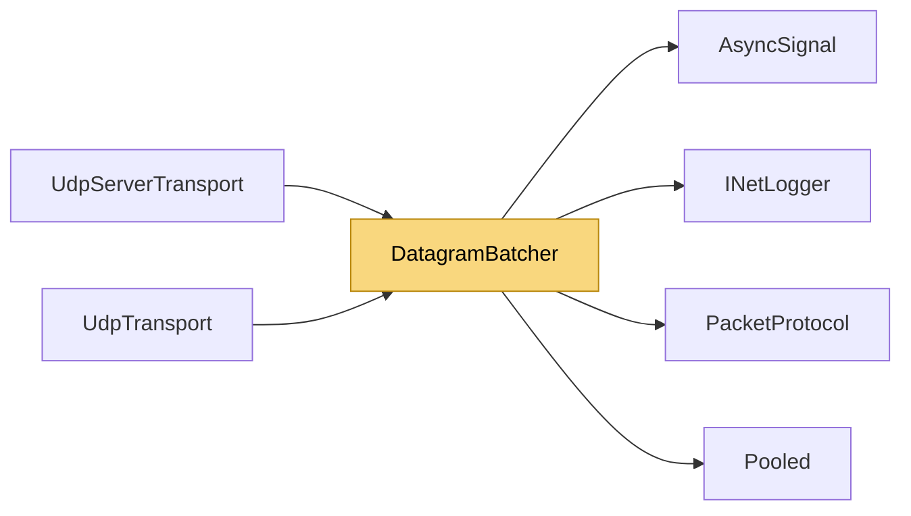

# DatagramBatcher

> [!info] Generated by `tools/generate-vault.py` from the source — do not edit by hand; rerun the script after code changes.

Packs small UDP packets into shared datagrams — one socket call carries many messages. Callers only copy their packet into the destination's open batch; one drain loop per transport sends the batches. While that loop is inside a socket call, new packets keep accumulating, so batching grows with load on its own and never delays a lone packet (no timer, no Nagle-style wait). A batch holding a single packet goes out as a plain Data datagram — the receiver sees exactly the pre-batching wire format. Wire format of a batch: [Batch][len][packet][len][packet]… where len is a 1–3 byte little-endian base-128 varint and each packet is the payload of a Data datagram. A batch never exceeds `MaxBatchSize` (below the IPv6 minimum MTU, so it is never IP-fragmented); larger packets go out alone, in order with the batched ones. The receive thread corks the batcher while it handles one datagram (`Cork`/`Uncork`): everything it sends in response — acks, replies — leaves together once the datagram is done, instead of the drain loop waking halfway and splitting it. Other threads are never held back by the cork. Bounded: a destination holds at most `MaxQueuedBytes`; beyond that new packets are dropped, exactly like a full socket buffer drops them (the reliability layer retransmits what matters).

**Namespace** `NetSync.Transports.Udp` · **Folder** [[Module map Transports Udp|Transports/Udp]] · **Layer** Transports

**Source** `src/NetSync/Transports/Udp/DatagramBatcher.cs`

## Types

| Type | Kind | Summary |
|---|---|---|
| `DatagramBatcher` | internal sealed class | Packs small UDP packets into shared datagrams — one socket call carries many messages. Callers only copy their packet into the destination's open batch; one drain loop per transport sends the batches. While that loop… |
| ↳ `Target` | internal sealed class | One destination's queue. The owner keeps it alongside the peer. |
| ↳ `Batch` | internal struct |  |
| ↳ `SendDatagram` | internal delegate | Sends buffer[offset..offset+length) to the target's destination. Must not block for long. |

## Extends / implements

- `DatagramBatcher` → `IDisposable`

## Members

**DatagramBatcher**

- `public const int MaxBatchSize = 1200`
- `public const int MaxQueuedBytes = 256 * 1024`
- `public DatagramBatcher(SendDatagram send, INetLogger logger)`
- `public Target CreateTarget(object? destination)`
- `public bool Enqueue(Target target, ReadOnlySpan<byte> prefix, ReadOnlySpan<byte> payload)`
- `public void Cork()`
- `public void Uncork()`
- `public void Close(Target target)`
- `public static void Unpack<TState>(byte[] buffer, int received, int maxPackets, TState state,`
- `internal static int VarIntSize(int value)`
- `internal static bool TryReadVarInt(byte[] buffer, ref int offset, int end, out int value)`
- `public void Dispose()`

**Target**

- `internal readonly object? Destination`
- `internal readonly Queue<Batch> Sealed = new Queue<Batch>()`
- `internal Batch Open`
- `internal int QueuedBytes`
- `internal bool Scheduled`
- `internal bool Closed`
- `internal Target(object? destination)`

**Batch**

- `public byte[]? Buffer`
- `public int Length`
- `public int Count`
- `public int FirstHeader`

## Depends on (4)

- **Transports**: [[PacketProtocol]] (`PacketType`)
- **Diagnostics**: [[INetLogger]]
- **Internal**: [[AsyncSignal]], [[Pooled]]

## Used by (2)

- **Transports/Udp**: [[UdpServerTransport]], [[UdpTransport]]

## Neighbourhood

