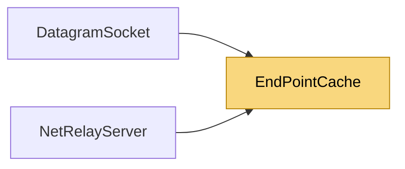

# EndPointCache

> [!info] Generated by `tools/generate-vault.py` from the source — do not edit by hand; rerun the script after code changes.

Allocation-free source addresses for unconnected UDP receives (net8.0): receive into `Address`, then `Resolve` returns the same `IPEndPoint` instance for a source seen before. Bounded — a flood of forged sources only costs the allocations it would have cost anyway. One receive thread per instance.

**Namespace** `NetSync.Transports.Udp` · **Folder** [[Module map Transports Udp|Transports/Udp]] · **Layer** Transports

**Source** `src/NetSync/Transports/Udp/EndPointCache.cs`

## Types

| Type | Kind | Summary |
|---|---|---|
| `EndPointCache` | internal sealed class | Allocation-free source addresses for unconnected UDP receives (net8.0): receive into `Address`, then `Resolve` returns the same `IPEndPoint` instance for a source seen before. Bounded — a flood of forged sources only… |
| `SocketAddressCache` | internal sealed class | The send-side counterpart (net8.0): Socket.SendTo(…, EndPoint) serializes the endpoint into a new SocketAddress on every call; this keeps one per destination. Thread-safe, bounded like `EndPointCache`. |
| `SocketAddressKey` | internal struct | A socket address compared by content. The hash is computed from the bytes on every call: receive loops rewrite one SocketAddress in place, so nothing about it may be cached. |

## Extends / implements

- `SocketAddressKey` → `IEquatable`

## Members

**EndPointCache**

- `public EndPointCache(AddressFamily family, int capacity)`
- `public SocketAddress Address`
- `public IPEndPoint Resolve()`

**SocketAddressCache**

- `public SocketAddressCache(AddressFamily socketFamily, int capacity)`
- `public SocketAddress For(IPEndPoint target)`

**SocketAddressKey**

- `public readonly SocketAddress Address`
- `public SocketAddressKey(SocketAddress address)`
- `public static SocketAddressKey Copy(SocketAddress source)`
- `public bool Equals(SocketAddressKey other)`
- `public override bool Equals(object? obj)`
- `public override int GetHashCode()`

## Depends on (0)

—

## Used by (2)

- **Relay**: [[DatagramSocket]] (`EndPointCache`, `SocketAddressCache`), [[NetRelayServer]] (`EndPointCache`, `SocketAddressCache`)

## Neighbourhood

