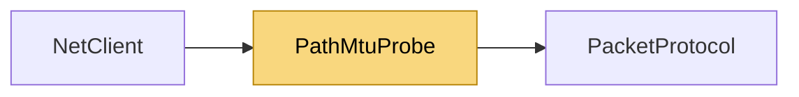

# PathMtuProbe

> [!info] Generated by `tools/generate-vault.py` from the source — do not edit by hand; rerun the script after code changes.

Measures how large a UDP datagram can travel to the server unfragmented: sends "don't fragment" probes of decreasing size from a side socket and takes the largest one the server's UDP port confirms. Routers drop a DF datagram that doesn't fit (and the OS refuses to send one above a known path MTU), so a confirmed size is a size that crossed the whole path in one piece. IPv4 only: .NET exposes the DF flag for IPv4 sockets, and IPv6 hosts fragment at the source anyway — IPv6 links keep the always-safe default.

**Namespace** `NetSync.Transports.Udp` · **Folder** [[Module map Transports Udp|Transports/Udp]] · **Layer** Transports

**Source** `src/NetSync/Transports/Udp/PathMtuProbe.cs`

## Types

| Type | Kind | Summary |
|---|---|---|
| `PathMtuProbe` | internal static class | Measures how large a UDP datagram can travel to the server unfragmented: sends "don't fragment" probes of decreasing size from a side socket and takes the largest one the server's UDP port confirms. Routers drop a DF… |

## Members

**PathMtuProbe**

- `public static async Task<int> ProbeAsync(IPEndPoint server, int timeoutMs, CancellationToken ct)`

## Depends on (1)

- **Transports**: [[PacketProtocol]] (`PacketType`)

## Used by (1)

- **Peers**: [[NetClient]]

## Neighbourhood

