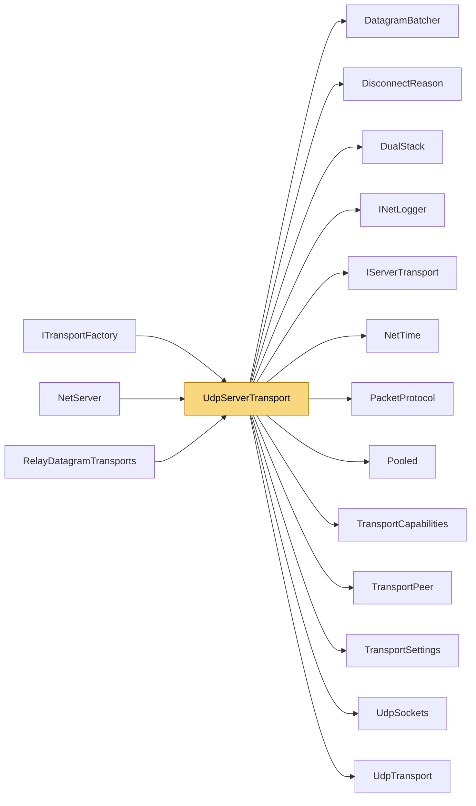

# UdpServerTransport

> [!info] Generated by `tools/generate-vault.py` from the source — do not edit by hand; rerun the script after code changes.

Server-side UDP transport. Tracks peers by source address, pings them actively and expires the silent ones. One socket, one receive thread, one reused buffer. On net8.0 source addresses are read into a reused `SocketAddress` and peers are looked up by it, so a datagram from a known peer costs no allocation in either direction. Sends go through one `DatagramBatcher`: small packets to the same peer share datagrams while the send loop is busy. Spoofing-aware: UDP source addresses are trivially forged, so a peer is only created by a Data datagram (pings from unknown sources are ignored — no reflection), and in trust-required mode untrusted peers are capped, get no keepalive traffic and expire unless the peer layer marks them trusted.

**Namespace** `NetSync.Transports.Udp` · **Folder** [[Module map Transports Udp|Transports/Udp]] · **Layer** Transports

**Source** `src/NetSync/Transports/Udp/UdpServerTransport.cs`

## Types

| Type | Kind | Summary |
|---|---|---|
| `UdpServerTransport` | public sealed class | Server-side UDP transport. Tracks peers by source address, pings them actively and expires the silent ones. One socket, one receive thread, one reused buffer. On net8.0 source addresses are read into a reused… |
| ↳ `AddressComparer` | private sealed class | Compares socket addresses by content, computing the hash from the bytes every time — the receive loop rewrites one SocketAddress in place, so nothing about it may be cached. |

## Extends / implements

- `UdpServerTransport` → `IServerTransport` ([[IServerTransport]])
- `UdpServerTransport` → `IPooledReceiveServerTransport` ([[TransportCapabilities]])
- `UdpServerTransport` → `IDatagramBoundaryServerTransport` ([[TransportCapabilities]])

## Members

**UdpServerTransport**

- `public const int MaxUntrustedPeers = 1024`
- `public int Port`
- `public bool IsRunning`
- `public event Action<TransportPeer>? PeerConnected`
- `public event Action<TransportPeer, DisconnectReason>? PeerDisconnected`
- `public event Action<TransportPeer, byte[]>? DataReceived`
- `internal Action<TransportPeer, byte[], int, int>? PooledReceive`
- `internal Action<TransportPeer>? DatagramCompleted`
- `internal bool RequireTrust`
- `internal Func<IPEndPoint, ReadOnlyMemory<byte>, byte[]?>? QueryHandler`
- `internal int UnconnectedPerSecond`
- `public UdpServerTransport(int pingIntervalMs = 1000, int pingTimeoutMs = 5000, INetLogger? logger = null)`
- `public UdpServerTransport(TransportSettings settings)`
- `public Task<int> StartAsync(int port, CancellationToken ct = default)`
- `internal void MarkTrusted(TransportPeer peer)`
- `public ValueTask SendAsync(TransportPeer peer, ReadOnlyMemory<byte> data, CancellationToken ct = default)`
- `public ValueTask SendAsync(TransportPeer peer, ReadOnlyMemory<byte> prefix, ReadOnlyMemory<byte> payload, CancellationToken ct = default)`
- `public void DisconnectPeer(TransportPeer peer)`
- `public async Task StopAsync()`
- `public void Dispose()`

## Depends on (13)

- **Transports**: [[DisconnectReason]], [[DualStack]], [[IServerTransport]], [[PacketProtocol]] (`PacketProtocol`, `PacketType`), [[TransportCapabilities]] (`IDatagramBoundaryServerTransport`, `IPooledReceiveServerTransport`, `ITrustAwareServerTransport`, `ReceivedPacket`), [[TransportPeer]], [[TransportSettings]]
- **Transports/Udp**: [[DatagramBatcher]], [[UdpSockets]], [[UdpTransport]]
- **Diagnostics**: [[INetLogger]]
- **Internal**: [[NetTime]], [[Pooled]]

## Used by (3)

- **Peers**: [[NetServer]]
- **Transports**: [[ITransportFactory]]
- **Relay**: [[RelayDatagramTransports]]

## Neighbourhood

