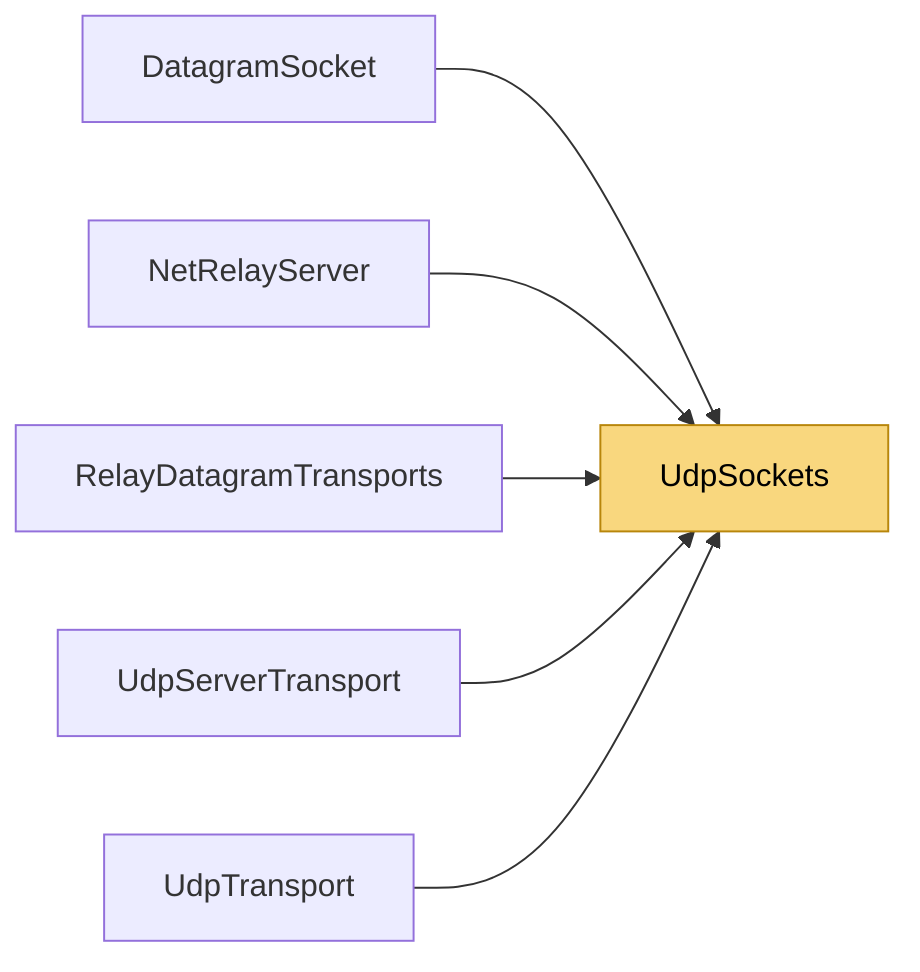

# UdpSockets

> [!info] Generated by `tools/generate-vault.py` from the source — do not edit by hand; rerun the script after code changes.

Socket setup shared by the UDP transports.

**Namespace** `NetSync.Transports.Udp` · **Folder** [[Module map Transports Udp|Transports/Udp]] · **Layer** Transports

**Source** `src/NetSync/Transports/Udp/UdpSockets.cs`

## Types

| Type | Kind | Summary |
|---|---|---|
| `UdpSockets` | internal static class | Socket setup shared by the UDP transports. |

## Members

**UdpSockets**

- `public const int ReceiveBufferSize = 64 * 1024`
- `public static Socket CreateClient(AddressFamily family)`
- `public static Socket BindServer(int port)`
- `public static bool IsTransient(SocketError error)`

## Depends on (0)

—

## Used by (5)

- **Transports/Udp**: [[UdpServerTransport]], [[UdpTransport]]
- **Relay**: [[DatagramSocket]], [[NetRelayServer]], [[RelayDatagramTransports]]

## Neighbourhood

