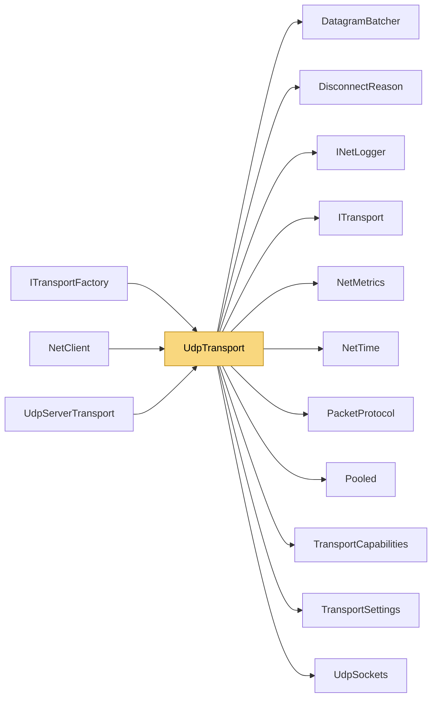

# UdpTransport

> [!info] Generated by `tools/generate-vault.py` from the source — do not edit by hand; rerun the script after code changes.

Client-side UDP transport. Connectionless at the socket level; liveness is tracked via ping/pong. The reliability layer adds retransmission, ordering and fragmentation on top. The socket is connected to the server: the OS drops datagrams from any other source, and both directions run without allocations. Sends are copied into a `DatagramBatcher` (packets queued during one socket call share the next datagram); receives run on a dedicated thread into one reused buffer. Payload limit: one datagram, ≤ `MaxDatagramPayload` bytes.

**Namespace** `NetSync.Transports.Udp` · **Folder** [[Module map Transports Udp|Transports/Udp]] · **Layer** Transports

**Source** `src/NetSync/Transports/Udp/UdpTransport.cs`

## Types

| Type | Kind | Summary |
|---|---|---|
| `UdpTransport` | public sealed class | Client-side UDP transport. Connectionless at the socket level; liveness is tracked via ping/pong. The reliability layer adds retransmission, ordering and fragmentation on top. The socket is connected to the server:… |
| ↳ `Connection` | private sealed class |  |

## Extends / implements

- `UdpTransport` → `ITransport` ([[ITransport]])
- `UdpTransport` → `IPooledReceiveTransport` ([[TransportCapabilities]])
- `UdpTransport` → `IDatagramBoundaryTransport` ([[TransportCapabilities]])

## Members

**UdpTransport**

- `public const int MaxDatagramPayload = 65506`
- `public bool IsConnected`
- `public int PingMs`
- `public NetMetrics? Metrics`
- `public event Action? Connected`
- `public event Action<DisconnectReason>? Disconnected`
- `public event Action<byte[]>? DataReceived`
- `internal Action<byte[], int, int>? PooledReceive`
- `internal Action? DatagramCompleted`
- `public UdpTransport(int pingIntervalMs = 1000, int pingTimeoutMs = 5000, INetLogger? logger = null)`
- `public UdpTransport(TransportSettings settings)`
- `public Task ConnectAsync(IPEndPoint endpoint, CancellationToken ct = default)`
- `public ValueTask SendAsync(ReadOnlyMemory<byte> data, CancellationToken ct = default)`
- `public ValueTask SendAsync(ReadOnlyMemory<byte> prefix, ReadOnlyMemory<byte> payload, CancellationToken ct = default)`
- `public void Disconnect()`
- `public void Dispose()`

## Depends on (11)

- **Transports**: [[DisconnectReason]], [[ITransport]], [[PacketProtocol]] (`PacketProtocol`, `PacketType`), [[TransportCapabilities]] (`IDatagramBoundaryTransport`, `IPooledReceiveTransport`, `ReceivedPacket`), [[TransportSettings]]
- **Transports/Udp**: [[DatagramBatcher]], [[UdpSockets]]
- **Diagnostics**: [[INetLogger]], [[NetMetrics]]
- **Internal**: [[NetTime]], [[Pooled]]

## Used by (3)

- **Peers**: [[NetClient]]
- **Transports**: [[ITransportFactory]]
- **Transports/Udp**: [[UdpServerTransport]]

## Neighbourhood

