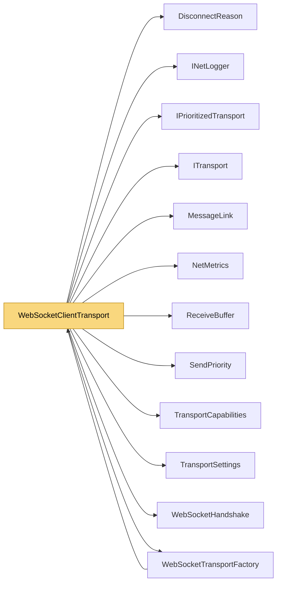

# WebSocketClientTransport

> [!NOTE]
> Generated by `tools/generate-vault.py` from the source — do not edit by hand; rerun the script after code changes.

Client side of `WebSocketTransportFactory`: NetSync packets as WebSocket messages (`MessageLink`), with ping/pong keepalive and a write watchdog.

**Namespace** `NetSync.Transports.WebSockets` · **Folder** [Transports/WebSockets](../../../4%20Diagrams/Modules/Module%20map%20Transports%20WebSockets.md) · **Layer** Transports

**Source** `src/NetSync/Transports/WebSockets/WebSocketClientTransport.cs`

## Types

| Type | Kind | Summary |
|---|---|---|
| `WebSocketClientTransport` | internal sealed class | Client side of `WebSocketTransportFactory`: NetSync packets as WebSocket messages (`MessageLink`), with ping/pong keepalive and a write watchdog. |
| ↳ `Connection` | private sealed class |  |

## Extends / implements

- `WebSocketClientTransport` → `ITransport` ([ITransport](../ITransport.md))
- `WebSocketClientTransport` → `IPrioritizedTransport` ([IPrioritizedTransport](../IPrioritizedTransport.md))
- `WebSocketClientTransport` → `IPooledReceiveTransport` ([TransportCapabilities](../TransportCapabilities.md))

## Members

**WebSocketClientTransport**

- `public bool IsConnected`
- `public int PingMs`
- `public NetMetrics? Metrics`
- `public event Action? Connected`
- `public event Action<DisconnectReason>? Disconnected`
- `public event Action<byte[]>? DataReceived`
- `internal Action<byte[], int, int>? PooledReceive`
- `public WebSocketClientTransport(WebSocketTransportFactory options, TransportSettings settings)`
- `public async Task ConnectAsync(IPEndPoint endpoint, CancellationToken ct = default)`
- `public ValueTask SendAsync(ReadOnlyMemory<byte> data, CancellationToken ct = default)`
- `public ValueTask SendAsync(ReadOnlyMemory<byte> prefix, ReadOnlyMemory<byte> payload, CancellationToken ct = default)`
- `public ValueTask SendAsync(ReadOnlyMemory<byte> prefix, ReadOnlyMemory<byte> payload, SendPriority priority, CancellationToken ct = default)`
- `public void Disconnect()`
- `public void Dispose()`

## Depends on (12)

- **Transports**: [DisconnectReason](../DisconnectReason.md), [IPrioritizedTransport](../IPrioritizedTransport.md), [ITransport](../ITransport.md), [MessageLink](../MessageLink.md), [ReceiveBuffer](../ReceiveBuffer.md), [TransportCapabilities](../TransportCapabilities.md) (`IPooledReceiveTransport`, `ReceivedPacket`), [TransportSettings](../TransportSettings.md)
- **Transports/WebSockets**: [WebSocketHandshake](WebSocketHandshake.md) (`WebSocketMessages`), [WebSocketTransportFactory](WebSocketTransportFactory.md)
- **Sending**: [SendPriority](../../Sending/SendPriority.md)
- **Diagnostics**: [INetLogger](../../Diagnostics/INetLogger.md), [NetMetrics](../../Diagnostics/NetMetrics.md)

## Used by (1)

- **Transports/WebSockets**: [WebSocketTransportFactory](WebSocketTransportFactory.md)

## Neighbourhood

