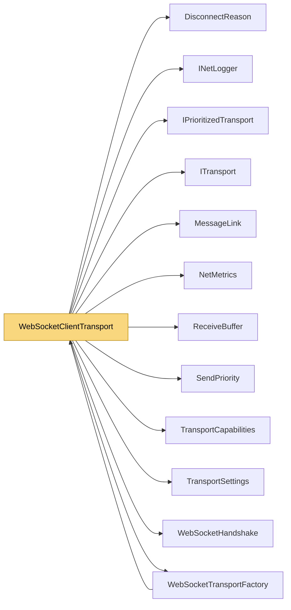

# WebSocketClientTransport

> [!info] Generated by `tools/generate-vault.py` from the source — do not edit by hand; rerun the script after code changes.

Client side of `WebSocketTransportFactory`: NetSync packets as WebSocket messages (`MessageLink`), with ping/pong keepalive and a write watchdog.

**Namespace** `NetSync.Transports.WebSockets` · **Folder** [[Module map Transports WebSockets|Transports/WebSockets]] · **Layer** Transports

**Source** `src/NetSync/Transports/WebSockets/WebSocketClientTransport.cs`

## Types

| Type | Kind | Summary |
|---|---|---|
| `WebSocketClientTransport` | internal sealed class | Client side of `WebSocketTransportFactory`: NetSync packets as WebSocket messages (`MessageLink`), with ping/pong keepalive and a write watchdog. |
| ↳ `Connection` | private sealed class |  |

## Extends / implements

- `WebSocketClientTransport` → `ITransport` ([[ITransport]])
- `WebSocketClientTransport` → `IPrioritizedTransport` ([[IPrioritizedTransport]])
- `WebSocketClientTransport` → `IPooledReceiveTransport` ([[TransportCapabilities]])

## Members

**WebSocketClientTransport**

- `public bool IsConnected`
- `public int PingMs`
- `public NetMetrics? Metrics`
- `public event Action? Connected`
- `public event Action<DisconnectReason>? Disconnected`
- `public event Action<byte[]>? DataReceived`
- `internal Action<byte[], int, int>? PooledReceive`
- `public WebSocketClientTransport(WebSocketTransportFactory options, TransportSettings settings)`
- `public async Task ConnectAsync(IPEndPoint endpoint, CancellationToken ct = default)`
- `public ValueTask SendAsync(ReadOnlyMemory<byte> data, CancellationToken ct = default)`
- `public ValueTask SendAsync(ReadOnlyMemory<byte> prefix, ReadOnlyMemory<byte> payload, CancellationToken ct = default)`
- `public ValueTask SendAsync(ReadOnlyMemory<byte> prefix, ReadOnlyMemory<byte> payload, SendPriority priority, CancellationToken ct = default)`
- `public void Disconnect()`
- `public void Dispose()`

## Depends on (12)

- **Transports**: [[DisconnectReason]], [[IPrioritizedTransport]], [[ITransport]], [[MessageLink]], [[ReceiveBuffer]], [[TransportCapabilities]] (`IPooledReceiveTransport`, `ReceivedPacket`), [[TransportSettings]]
- **Transports/WebSockets**: [[WebSocketHandshake]] (`WebSocketMessages`), [[WebSocketTransportFactory]]
- **Sending**: [[SendPriority]]
- **Diagnostics**: [[INetLogger]], [[NetMetrics]]

## Used by (1)

- **Transports/WebSockets**: [[WebSocketTransportFactory]]

## Neighbourhood

