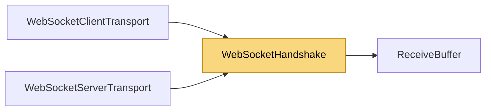

# WebSocketHandshake

> [!info] Generated by `tools/generate-vault.py` from the source — do not edit by hand; rerun the script after code changes.

Server side of the RFC 6455 opening handshake, on a raw (or TLS) stream. Deliberately strict and small: bounded request size, GET on the configured path, the mandatory headers, an optional Origin allow-list. Anything else gets a plain HTTP error.

**Namespace** `NetSync.Transports.WebSockets` · **Folder** [[Module map Transports WebSockets|Transports/WebSockets]] · **Layer** Transports

**Source** `src/NetSync/Transports/WebSockets/WebSocketHandshake.cs`

## Types

| Type | Kind | Summary |
|---|---|---|
| `WebSocketHandshake` | internal static class | Server side of the RFC 6455 opening handshake, on a raw (or TLS) stream. Deliberately strict and small: bounded request size, GET on the configured path, the mandatory headers, an optional Origin allow-list. Anything… |
| ↳ `Result` | public enum |  |
| `WebSocketMessages` | internal static class | Reading whole binary messages into a bounded buffer. |

## Members

**WebSocketHandshake**

- `public static async Task<Result> AcceptAsync(Stream stream, string path, IReadOnlyCollection<string> allowedOrigins, CancellationToken ct)`

**WebSocketMessages**

- `public const int Closed = -2`
- `public const int Violation = -1`
- `public static async ValueTask<int> ReceiveAsync(WebSocket socket, ReceiveBuffer buffer, int limit, CancellationToken ct)`

## Depends on (1)

- **Transports**: [[ReceiveBuffer]]

## Used by (2)

- **Transports/WebSockets**: [[WebSocketClientTransport]] (`WebSocketMessages`), [[WebSocketServerTransport]] (`WebSocketHandshake`, `WebSocketMessages`)

## Neighbourhood

