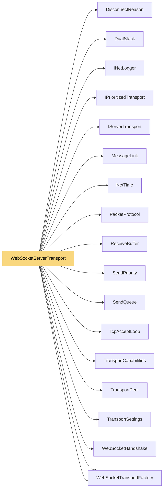

# WebSocketServerTransport

> [!NOTE]
> Generated by `tools/generate-vault.py` from the source — do not edit by hand; rerun the script after code changes.

Server side of `WebSocketTransportFactory`: a TCP listener that performs the HTTP upgrade itself (optionally inside TLS), then speaks the same packets as the client. Same hardening as the TCP server: per-peer priority queue, write watchdog, tiny message limit until the handshake vouches for the peer, bounded handshake time.

**Namespace** `NetSync.Transports.WebSockets` · **Folder** [Transports/WebSockets](../../../4%20Diagrams/Modules/Module%20map%20Transports%20WebSockets.md) · **Layer** Transports

**Source** `src/NetSync/Transports/WebSockets/WebSocketServerTransport.cs`

## Types

| Type | Kind | Summary |
|---|---|---|
| `WebSocketServerTransport` | internal sealed class | Server side of `WebSocketTransportFactory`: a TCP listener that performs the HTTP upgrade itself (optionally inside TLS), then speaks the same packets as the client. Same hardening as the TCP server: per-peer… |
| ↳ `PeerState` | private sealed class |  |

## Extends / implements

- `WebSocketServerTransport` → `IPeerFlushingServerTransport` ([TransportCapabilities](../TransportCapabilities.md))
- `WebSocketServerTransport` → `IServerTransport` ([IServerTransport](../IServerTransport.md))
- `WebSocketServerTransport` → `IPrioritizedServerTransport` ([IPrioritizedTransport](../IPrioritizedTransport.md))

## Members

**WebSocketServerTransport**

- `public int Port`
- `public bool IsRunning`
- `public event Action<TransportPeer>? PeerConnected`
- `public event Action<TransportPeer, DisconnectReason>? PeerDisconnected`
- `public event Action<TransportPeer, byte[]>? DataReceived`
- `internal Action<TransportPeer, byte[], int, int>? PooledReceive`
- `internal bool RequireTrust`
- `public WebSocketServerTransport(WebSocketTransportFactory options, TransportSettings settings)`
- `public Task<int> StartAsync(int port, CancellationToken ct = default)`
- `public ValueTask SendAsync(TransportPeer peer, ReadOnlyMemory<byte> data, CancellationToken ct = default)`
- `public ValueTask SendAsync(TransportPeer peer, ReadOnlyMemory<byte> prefix, ReadOnlyMemory<byte> payload, CancellationToken ct = default)`
- `public ValueTask SendAsync(TransportPeer peer, ReadOnlyMemory<byte> prefix, ReadOnlyMemory<byte> payload, SendPriority priority, CancellationToken ct = default)`
- `public void DisconnectPeer(TransportPeer peer)`
- `public async Task StopAsync()`
- `public void Dispose()`

## Depends on (17)

- **Transports**: [DisconnectReason](../DisconnectReason.md), [DualStack](../DualStack.md), [IPrioritizedTransport](../IPrioritizedTransport.md) (`IPrioritizedServerTransport`), [IServerTransport](../IServerTransport.md), [MessageLink](../MessageLink.md), [PacketProtocol](../PacketProtocol.md), [ReceiveBuffer](../ReceiveBuffer.md), [TcpAcceptLoop](../TcpAcceptLoop.md), [TransportCapabilities](../TransportCapabilities.md) (`IPeerFlushingServerTransport`, `IPooledReceiveServerTransport`, `ITrustAwareServerTransport`, `ReceivedPacket`), [TransportPeer](../TransportPeer.md), [TransportSettings](../TransportSettings.md)
- **Transports/WebSockets**: [WebSocketHandshake](WebSocketHandshake.md) (`WebSocketHandshake`, `WebSocketMessages`), [WebSocketTransportFactory](WebSocketTransportFactory.md)
- **Sending**: [SendPriority](../../Sending/SendPriority.md), [SendQueue](../../Sending/SendQueue.md)
- **Diagnostics**: [INetLogger](../../Diagnostics/INetLogger.md)
- **Internal**: [NetTime](../../Internal/NetTime.md)

## Used by (1)

- **Transports/WebSockets**: [WebSocketTransportFactory](WebSocketTransportFactory.md)

## Neighbourhood

