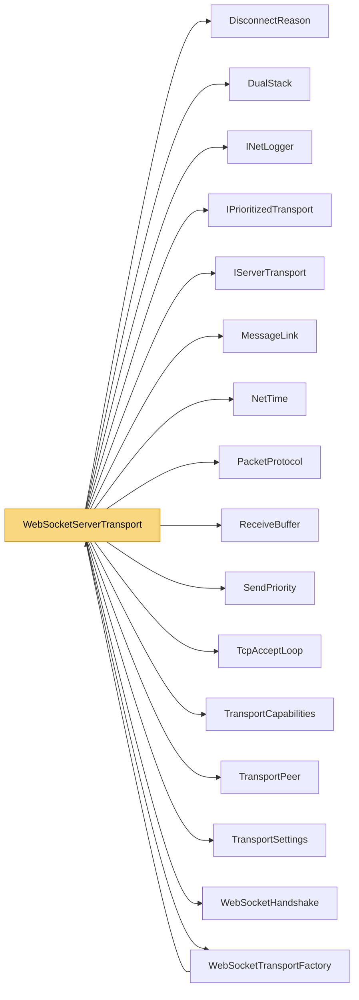

# WebSocketServerTransport

> [!info] Generated by `tools/generate-vault.py` from the source — do not edit by hand; rerun the script after code changes.

Server side of `WebSocketTransportFactory`: a TCP listener that performs the HTTP upgrade itself (optionally inside TLS), then speaks the same packets as the client. Same hardening as the TCP server: per-peer priority queue, write watchdog, tiny message limit until the handshake vouches for the peer, bounded handshake time.

**Namespace** `NetSync.Transports.WebSockets` · **Folder** [[Module map Transports WebSockets|Transports/WebSockets]] · **Layer** Transports

**Source** `src/NetSync/Transports/WebSockets/WebSocketServerTransport.cs`

## Types

| Type | Kind | Summary |
|---|---|---|
| `WebSocketServerTransport` | internal sealed class | Server side of `WebSocketTransportFactory`: a TCP listener that performs the HTTP upgrade itself (optionally inside TLS), then speaks the same packets as the client. Same hardening as the TCP server: per-peer… |
| ↳ `PeerState` | private sealed class |  |

## Extends / implements

- `WebSocketServerTransport` → `IServerTransport` ([[IServerTransport]])
- `WebSocketServerTransport` → `IPrioritizedServerTransport` ([[IPrioritizedTransport]])

## Members

**WebSocketServerTransport**

- `public int Port`
- `public bool IsRunning`
- `public event Action<TransportPeer>? PeerConnected`
- `public event Action<TransportPeer, DisconnectReason>? PeerDisconnected`
- `public event Action<TransportPeer, byte[]>? DataReceived`
- `internal Action<TransportPeer, byte[], int, int>? PooledReceive`
- `internal bool RequireTrust`
- `public WebSocketServerTransport(WebSocketTransportFactory options, TransportSettings settings)`
- `public Task<int> StartAsync(int port, CancellationToken ct = default)`
- `public ValueTask SendAsync(TransportPeer peer, ReadOnlyMemory<byte> data, CancellationToken ct = default)`
- `public ValueTask SendAsync(TransportPeer peer, ReadOnlyMemory<byte> prefix, ReadOnlyMemory<byte> payload, CancellationToken ct = default)`
- `public ValueTask SendAsync(TransportPeer peer, ReadOnlyMemory<byte> prefix, ReadOnlyMemory<byte> payload, SendPriority priority, CancellationToken ct = default)`
- `public void DisconnectPeer(TransportPeer peer)`
- `public async Task StopAsync()`
- `public void Dispose()`

## Depends on (16)

- **Transports**: [[DisconnectReason]], [[DualStack]], [[IPrioritizedTransport]] (`IPrioritizedServerTransport`), [[IServerTransport]], [[MessageLink]], [[PacketProtocol]], [[ReceiveBuffer]], [[TcpAcceptLoop]], [[TransportCapabilities]] (`IPooledReceiveServerTransport`, `ITrustAwareServerTransport`, `ReceivedPacket`), [[TransportPeer]], [[TransportSettings]]
- **Transports/WebSockets**: [[WebSocketHandshake]] (`WebSocketHandshake`, `WebSocketMessages`), [[WebSocketTransportFactory]]
- **Sending**: [[SendPriority]]
- **Diagnostics**: [[INetLogger]]
- **Internal**: [[NetTime]]

## Used by (1)

- **Transports/WebSockets**: [[WebSocketTransportFactory]]

## Neighbourhood

