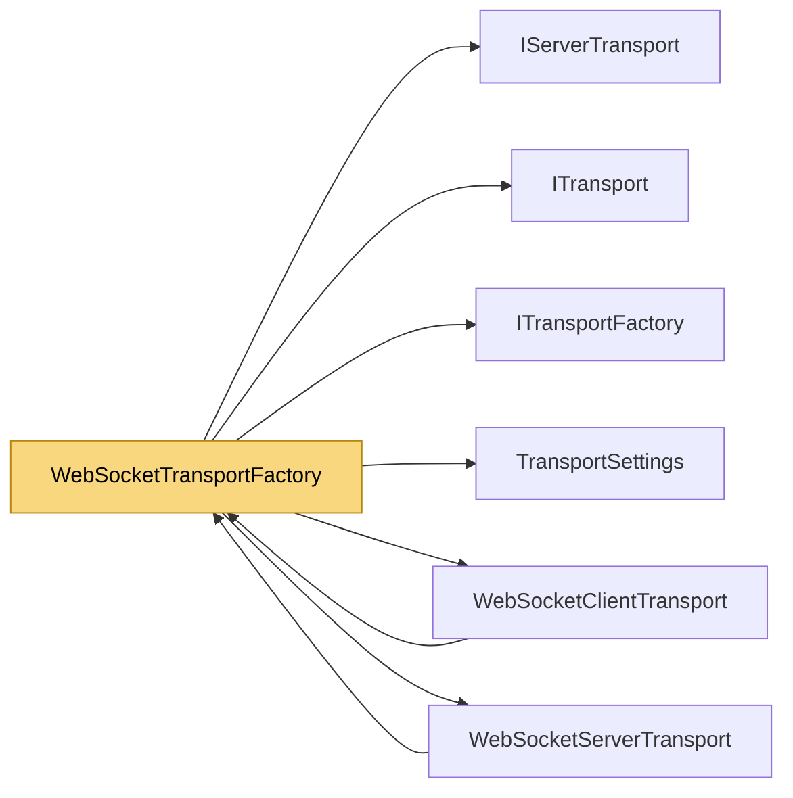

# WebSocketTransportFactory

> [!info] Generated by `tools/generate-vault.py` from the source — do not edit by hand; rerun the script after code changes.

WebSocket transport for the `Tcp` slot — the way browsers (WebAssembly, Blazor) and networks that only let HTTP(S) through reach a NetSync server. The whole stack runs on top unchanged: channels, handshake, encryption, approval. Server: `server.AddListener(TransportType.Tcp, new WebSocketTransportFactory(), 8080)` next to the native TCP/UDP listeners — both kinds of clients share one server. Give it a `ServerCertificate` for wss:// (required by pages served over https). Client: `config.TransportFactories[TransportType.Tcp] = new WebSocketTransportFactory { UseTls = true, HostName = "game.example.com" }`. Where UDP is unavailable (browsers), UDP channels automatically ride the WebSocket (`RequireAllTransports` = false). Wire format: one binary WebSocket message per packet, [type:1][payload] — the same packets as UDP; messages of 64 KB and more are sent as fragments so small traffic never waits behind a file.

**Namespace** `NetSync.Transports.WebSockets` · **Folder** [[Module map Transports WebSockets|Transports/WebSockets]] · **Layer** Transports

**Source** `src/NetSync/Transports/WebSockets/WebSocketTransportFactory.cs`

## Types

| Type | Kind | Summary |
|---|---|---|
| `WebSocketTransportFactory` | public sealed class | WebSocket transport for the `Tcp` slot — the way browsers (WebAssembly, Blazor) and networks that only let HTTP(S) through reach a NetSync server. The whole stack runs on top unchanged: channels, handshake,… |

## Extends / implements

- `WebSocketTransportFactory` → `ITransportFactory` ([[ITransportFactory]])

## Members

**WebSocketTransportFactory**

- `public string Path`
- `public bool UseTls`
- `public string? HostName`
- `public RemoteCertificateValidationCallback? RemoteCertificateValidation`
- `public X509Certificate2? ServerCertificate`
- `public List<string> AllowedOrigins`
- `public ITransport CreateClient(TransportSettings settings)`
- `public IServerTransport CreateServer(TransportSettings settings)`

## Depends on (6)

- **Transports**: [[IServerTransport]], [[ITransport]], [[ITransportFactory]], [[TransportSettings]]
- **Transports/WebSockets**: [[WebSocketClientTransport]], [[WebSocketServerTransport]]

## Used by (2)

- **Transports/WebSockets**: [[WebSocketClientTransport]], [[WebSocketServerTransport]]

## Neighbourhood

